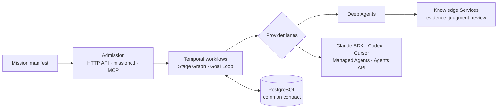

# Mission Control

**A durable control plane for multi-agent "missions": it schedules work across frontier agent frameworks and keeps every agent
session inspectable, forkable and steerable.**

Mission Control takes a declarative *mission* (a goal, a workflow shape, the agents and capabilities it may use, and the outputs it
promises) and runs it to an evidence-backed result. [Temporal](https://temporal.io) owns scheduling and recovery, PostgreSQL owns
state, and each agent runtime plugs in as a *provider lane* behind one provider-neutral contract.
[Deep Agents](https://github.com/langchain-ai/deepagents) (LangGraph) is the primary lane. Claude Agent SDK, Codex, Cursor,
Claude Managed Agents and the OpenAI Agents API use the same adapter boundary.

Built and maintained by [John Overton Bell](https://github.com/jbell-rusty-vantage).



### What it does

- **Workflow systems as data.** A mission manifest compiles to a Stage Graph (stages that release, route and revisit) or a
  goal-directed run with produce, verify and repair rounds. Parallel Swarm is built as a Stage Graph profile, and the full Goal
  Loop and evaluator-optimizer scoring are being built on the same machinery. Pure interpreters propose transitions, and reducers
  own lifecycle and settlement.
- **Control over live agent sessions.** Every lane records step-level *cognition points*, so an operator or coordinator agent can
  read state as of any step, fork from it, queue work, interrupt and steer. This is proven locally on Deep Agents and is implemented
  but not yet live-proven on the other lanes.
- **Output contracts.** Named deliverables are submitted, independently judged and audited, then sealed with source attribution
  before a mission counts as fulfilled.
- **One governed database contract.** A versioned common schema with releases, attested installs, restricted runtime roles and
  row-level security, shared by the applications built on it (AI Engineer and Biotech).
- **Hexagonal architecture.** Domain code imports no database, Temporal, web framework or provider SDK. Adapters implement
  application ports, and architecture tests enforce the boundaries.

### Status

Active development, in startup mode. The scheduling, control and output machinery for Deep Agents is implemented, tested and
integrated against disposable PostgreSQL/Temporal targets. The first release gate (W0) has passed, and later gates are in progress.
This repository separates *implemented*, *tested*, *integrated* and *qualified* claims
([qualification](docs/knowledge/qualification.md)). The design record is 68 ADRs in [`docs/adr`](docs/adr), with concepts in
[`docs/knowledge`](docs/knowledge/index.md).

**Stack:** Python 3.12 · Temporal · LangGraph / Deep Agents · FastAPI · PostgreSQL 17 + pgvector · psycopg 3 · MCP ·
uv, ruff, mypy, ty and pytest. The repository has about 1,000 source modules and 1,200 test files.

### License

No open-source license is granted yet. The code is public to read and review, and all rights are reserved. To use or build on
it, open an issue or contact the author through GitHub.

## Operating it

General mission execution with governed admission, StageGraph and GoalDirected
programs, durable lifecycle controls, and bounded Deep Agents cognition. Temporal
owns execution; PostgreSQL owns application state.

Start with the [operator guide](docs/MISSION_CONTROL_LOCAL_API.md), the
[knowledge bundle](docs/knowledge/index.md), and the
[implementation evidence](docs/specs/archive/mc-surfaces-2026-10/docs/MISSION_CONTROL_IMPLEMENTATION_STATUS.md).
The [removal guide](docs/specs/archive/mc-surfaces-2026-10/docs/REMOVAL_GUIDE.md) records the clean break, recovery
checkpoints, changed imports and remaining qualification gates.

The common database component is built and tested locally through release 1.12.0 and installed on the two disposable Sprint OC
remotes at 1.8.0 (see [database component](docs/knowledge/database-component.md) for the release table, the locks and what is
installed where). The October 2026 two-project rollout plan and its evidence are archived under
`docs/specs/archive/mc-surfaces-2026-10/`.

## Repository history

This repository starts at a clean-slate baseline (2026-11-06), made when Mission Control moved to the jbell-rusty-vantage GitHub
account. It has one root commit whose tree equals the last pre-move `main`, and only `main` is published. Commit IDs cited in older
docs are not in this history; see [repository history](docs/REPOSITORY-HISTORY.md).

## Source and architecture

One Python distribution imports `mission_control` from `src/mission_control`.
Common database SQL, its release builder and the `mission-db` installer live in
`packages/mission-control-db-contract/` (the sole common SQL owner); per-app target
manifests live in `deployments/<app>/`.
Contracts, domain, application, adapters, interfaces and bootstrap have separate
ownership; scoped AGENTS.md files explain local logic and test navigation.

What Mission Control owns and refuses is in [`mission-control`](docs/knowledge/mission-control.md); the decisions are in
[`docs/adr`](docs/adr) and the concepts in [`docs/knowledge`](docs/knowledge/index.md).
Application domain logic is isolated in the optional `integrations/biotech/`
package. Broad KnowledgeServices generalization remains separate work.

## Local operation

```powershell
make install          # uv sync with the dev, dbcontract and biotech groups
make dev              # docker compose up -d, wait for health, print next steps
make server           # API on http://127.0.0.1:8000 (RELOAD=1 for autoreload)
make worker           # separate terminal; needs the selected application and binding pin
make agent-server     # Agent Server (langgraph dev) on :2024
```

The underlying commands, every infrastructure/database/test target and the tool
rationale are in the [developer tooling guide](docs/DEVELOPMENT.md); `make help` lists
all targets.

These commands require the operator-owned deployment, installation identity,
restricted database roles, accepted runtime options and credentials described in
the operator guide. Startup does not migrate or seed. `missionctl` uses the
authenticated application-scoped API. The canonical downloadable skill is
`skills/mission-control/`; Agent Server configuration is `agent_server/langgraph.json`.

Startup accepts only `storage_mode = "production_common"`: it verifies the
persisted installation identity, the complete attested common release
(`mission_control` + `mission_control_search`), writer compatibility and restricted
pool roles, and fails closed otherwise; there is no transitional fallback. Which release is built and which is installed
where is in [database component](docs/knowledge/database-component.md).

## Checks

```powershell
make check            # ruff lint + format check, ty, deptry, architecture + unit tests, lane conformance, skills manifests
make ci               # adds mypy, uv lock --check and the docs link checker
uv run ruff check .
uv run mypy
uv run --group biotech pytest
# Independent two-project qualification (loopback disposable PostgreSQL 17 + pgvector;
# fails, never skips, without MISSION_CONTROL_TEST_ADMIN_DSN)
uv run --no-sync pytest tests/qualification/two_project
python docs/tools/check_links.py
```

Plain `uv sync` installs the general runtime without Neo4j/GraphQL domain dependencies.
Use `uv sync --group biotech` when developing/testing the optional Biotech integration;
the full test command above enables that group explicitly.

Integration and acceptance suites state their required PostgreSQL/Temporal
services. Deterministic local proof does not certify live provider, Supabase,
storage-policy or operating-system mount behavior. Do not enable paid experiments
without a finite budget, or remove database volumes to repair a test.

No historical Mongo backfill, endpoint aliases or old execution-history support
is required by this clean break. Existing user data and unrelated local work are
preserved; the removal guide distinguishes removed implementation from data.
