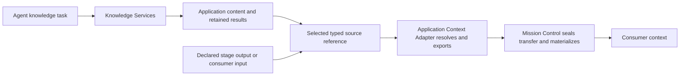

# Configurable context transfer within and between missions

<!-- final-output-contracts-2026-10-26 -->
**Converted, 2026-10-26:** the [final implementation packet](../../../../provider-consolidation-2026-10/sprint-oc/README.md) and [OVE-162](https://linear.app/overtonbell/issue/OVE-162/oc-final-output-contracts-exact-context-and-knowledge-service) supersede output/transfer planning and interview-resume instructions here. The [canonical target](../../../../../knowledge/output-contracts.md) controls adopted behavior; [DECISIONS](../../../../provider-consolidation-2026-10/sprint-oc/DECISIONS.md) disposes every OC/DP/CS recommendation and older ADR candidate. Retained source/proof claims remain historical and scoped. Start [KICKOFF](../../sessions/KICKOFF.md); no new interview or runtime completion is implied.

Companion to [the output-obligations specification](SPECIFICATION.md), grounded in the owner's
[verbatim answers](ANSWERS.md). This working specification distinguishes confirmed product behavior,
recommended implementation shape and open decisions. It is not a claim that the current adapters
already implement every boundary or that an implementation sprint has been accepted.

## 1. Confirmed requirements

| Decision | Required behavior |
| --- | --- |
| OC-D52 | Applicable contract versions, current deliverable/revision index, unmet obligations, verifier findings, revision/invalidation facts and access to declared inputs are mandatory at relevant cycle/iteration boundaries. Missing required context blocks or triggers repair; no silent omission for context size. |
| OC-D53 | Make transfer a substantial part of the interview/specifications, both within a mission/workflow and between missions/workflows, including coordinator/client control. |
| OC-D54 | Same versioned manifest/API authoring surface for coordinators and client callers; reusable profiles or inline settings; mission defaults and per-input/per-link overrides; system enforces policy and refuses conflicting requirements. |
| OC-D55 | Distinguish required access/form from preferences. Automatic planning can choose only authored acceptable alternatives; a summary or unusable reference cannot replace required source content. |
| OC-D56 | Cross-mission default: explicitly mapped outputs, required evidence/provenance and acceptance/revision facts, compact relevant producer outcomes; broader history opt-in and scoped. Receiver retains its own goals, obligations, budget and authority. Unfinished work needs explicit delegation/adoption. |
| OC-D57 | Optional agent-based preparation is an explicit budgeted operation with source references and an output contract. It supplements authoritative state and required inputs; final packet assembly is deterministic. |
| OC-D58 | Select named content/relationships with bounded expansion; output validation does not imply recursive content transfer. |
| OC-D59 | Guarantee required input availability for the declared execution/recovery period through retention or permitted immutable snapshots/exports; otherwise refuse. |
| OC-D60 | Govern live additions/changes at safe boundaries; preserve sealed history and apply revision/staleness rules to required input changes. |
| OC-D61 | Repair only within authored retries, alternatives, preparation, capabilities and budget; then block without silently weakening requirements. |
| OC-D62 | Prioritize modular application-storage access so Mission Control remains a general system related to application entities/content. Copy-all versus selective custody is not yet decided. |
| OC-D63 | Ground this line of questioning with GPT-6.1-Sol inspection of application storage and Mission Control/Deep Agents persistence; separate evidence from deployment assumptions. |
| OC-D64 | Application content remains canonical in its owning application; Mission Control registers references/provenance and selective retained results, including sufficiently durable external custody. |
| OC-D65 | Application modules implement common versioned contracts with deterministic, seamless Mission Control reading, materialization and transfer. |
| OC-D66 | Retain exact bounded read results and reuse them until explicit or authored refresh; preserve actual backend consistency and record the new result/version. |
| OC-D67 | Agent-directed knowledge discovery/navigation through Knowledge Services is distinct from materialization/transfer. Possible Financial/Content/Research and Evidence service boundaries are illustrative, not final. |
| OC-D68 | Typed application/source and exact native revision or retained-result references enable automatic resolution/export for both produced outputs and pre-existing inputs. |
| OC-D69 | Declared, versioned deterministic renderers/projections can supply a required representation; retain source/transformation/result identity and keep semantic preparation separate. |
| OC-D70 | Preserve original artifact and ingested domain identities with explicit receipt-backed native mappings; bindings can select the original, domain version or allowed export. |

Related confirmed decisions: revisions are tracked by default with explicit snapshot bindings
(OC-D49); consumers wait for stage completion unless incremental delivery is explicitly authored
(OC-D47); incomplete-result consumption is separately explicit (OC-D34); layered output guarantees
are declared and checked independently (OC-D39).

## 2. What the current code does

Read-only inspection at the recorded commit. Paths in this section are repository-relative.

| Surface | Implemented source evidence | Limit this specification must address |
| --- | --- | --- |
| Authored stage inputs | `domain/authoring/manifest.py:705-728` under `src/mission_control/`: name, exactly one of from/artifact/value, schema, expand, required | The presence of a field does not prove every lowering path enforces it. |
| Stage expansion | `application/context/pack_service.py:1152-1172`: consumer input name and expand influence binding; fallback auto | No general mission/per-link transfer-policy resolution is demonstrated. |
| Required binding | `domain/context/packet.py:606-611`: ContextBinding has mandatory, default false; `application/context/pack_service.py:356-358` creates name/expand without mapping authored required | Explicit end-to-end gap: required input authoring must survive compilation, planning, delivery and retrieval. |
| Packer policy | `application/context/pack_service.py:282-299` supplies a central ContextPackPolicy; `domain/context/packet.py:566-581` defines thresholds/caps/trust policy | Per-node override wording is not evidence of public authoring plumbing. |
| Hard failures | `domain/context/packet.py:136-140`, `:1110-1132`: unavailable/oversized mandatory items fail with typed errors | Ref existence is not sufficient: actual permitted retrieval must meet the consumer's requirement. |
| Chain binding | `domain/composition/chain.py:121-143`: producer output, consumer input, schema, expansion; release and cancellation are separate link fields | A useful existing seam, but not complete transfer semantics for all linked-run forms. |
| Linked-run control | `domain/composition/contracts.py:26-41`: target, compilation, budget, dependency and authority | A control/dependency link is not automatically a rich named data-transfer contract. |
| Provider realization | `domain/context/packet.py:584-591`, `:919-941`: workspace/text-only/mount facts affect representation; optional unsupported materialization can fall back | Must enforce authored acceptable alternatives and never quietly weaken a required form. |
| Chain workspace behavior | `docs/knowledge/mission-chains.md:59-65`: registered artifacts transferred; supplier workspace not restored | Code workspace transfer needs explicit capability and proof, not an implied shared mutable workspace. |

All abbreviated source paths above are under `src/mission_control/`. Accepted ADR 0027 establishes
sealed packets and inline/reference/materialize/workspace tiers. The existing OC proposal's §4.2
describes a transfer policy module and authored overrides, but that module is proposed. Its H9
fallback to references must be constrained by OC-D55: a reference is acceptable only when it meets
the consumer's declared access/form requirements.

## 3. Authority and configuration

**Confirmed product boundary; proposed exact resolution design.**

| Participant | Declares | Cannot do through a transfer setting |
| --- | --- | --- |
| Producer | Available named outputs, exact identities/revisions, content contracts, provenance, representations and permitted export | Dictate every consumer's context or grant access it does not control |
| Consumer | Input contracts, required content/access/form, allowed alternatives, preferences and history needs | Claim an unavailable capability, rewrite producer facts or waive an obligation it lacks authority to change |
| Link | Named output-to-input mapping, release condition, tracking/snapshot behavior, incremental trigger and agreed representation constraints | Treat control ordering as an implicit export of all producer data |
| Runtime | Authority, custody/integrity, mandatory state, budget and lane feasibility; effective plan and delivery evidence | Quietly drop required information, invent ingestion/assessment facts, widen grants or rewrite used packets |

A profile supplies reusable defaults. Inline authoring can specify the same supported fields. Mission
defaults apply to the mission's transfers; input/link settings specialize them. The resolver must
distinguish **preferences/defaults** from **hard constraints**. Preferences can have a documented
specificity order; hard constraints combine and must remain satisfiable. A more-specific preference
does not override access policy, consumer required guarantees or mandatory system state.

Exact unit-level inheritance and conflict precedence are proposed implementation details to freeze in
the contract schema. In particular, do not implement a recursive last-writer-wins merge of all fields.
The coordinator and a client use the same validation, admission, grants and effective-plan inspection.
Neither writes the sealed Context Packet directly.

The author should be able to inspect both authored and effective configuration, the origin of inherited
values, fixed constraints, the plan and actual delivery. These are recommended observability outputs
of an enforceable configurable contract, not another hidden agent instruction format.

## 4. Transfer agreement: proposed fields

The following semantic fields are a schema design checklist, not finalized manifest syntax.

| Field group | Meaning |
| --- | --- |
| Identity/version | Transfer-contract identity/digest, profile pins and effective configuration digest |
| Boundary | Purpose, source/target mission/run/unit identities and relevant activation/generation coordinates |
| Binding | Producer named obligation/output selector -> consumer named input; required or optional; compatible content contract |
| Source revision | Exact resolved item versions, tracking versus snapshot policy, accepted/provisional disposition |
| Required access | Content/parts that must be accessible, required delivery forms and permitted alternatives |
| Preferred form | auto, inline, materialized file, retrievable reference, workspace capability; subject to hard requirements |
| Expansion | Selected members/relationships and bounded reference expansion; confirmed OC-D58 |
| Current state | Purpose-specific mandatory facts: obligations, findings, current deliverables, revisions/invalidation and release facts |
| History | Explicit authorized scope: selected transcript ranges, prior outputs/packets and provenance handles; on-demand versus materialized |
| Preparation | Optional admitted operation bindings for summaries or other derived context, output contract and independent budget |
| Resources | Prompt tokens, file bytes/count, retrieval/preparation spend and duration bounds; no implicit budget increases |
| Availability | Declared execution/recovery/replay period, retention or permitted immutable export commitment; confirmed OC-D59 |
| Change handling | Update trigger, safe application point, immutable prior packets and revision/staleness impact; confirmed OC-D60 |
| Failure handling | Allowed retries/alternatives/preparation and their bounds; block when hard requirements remain unmet; confirmed OC-D61 |

**Required content is not synonymous with inline content.** A consumer may require complete report
bytes as read-only files while only an index appears in the prompt. Another consumer may accept exact,
authenticated retrieval handles. A local-file requirement is not satisfied by a URL; a requirement
for source content is not satisfied by a summary. The actual allowable set comes from the contract.

Whether content was delivered, retrieved, used in a tool call, or faithfully reflected in the final
output are different facts. A delivery receipt can establish availability/materialization. It cannot
prove an LLM read, understood or relied on the material. Output provenance/assessments address the
declared evidence-use requirements separately.

## 5. Boundary semantics

Use one general transfer model with purpose-specific mandatory state, rather than separate rules
invented independently by each provider. Proposed coverage matrix:

| Boundary | Data selection and state | Special constraint |
| --- | --- | --- |
| Dependent stage | Named output/input bindings, producer disposition, exact revisions, release reason, consumer's own obligations | Ordering-only dependencies do not imply all data is required. Partial/incremental/provisional policies are explicit and distinct. |
| Cycling stage | Own current accepted set, prior-cycle findings, unmet obligations, revised objective, contract versions, invalidations | Accepted revisions count once per distinct identity; new drafts do not erase accepted state. |
| Goal executor -> verifier | Whole current goal set, proposed changes, obligations, exact evidence/contract versions | Verifier observes an exact set; its access must preserve executor/verifier isolation. |
| Goal verifier -> next executor | Current accepted set plus verdict, findings, unresolved obligations and repair/revision facts | Do not depend solely on what the executor elected to include in its handoff. |
| Session continuation | Same unit's sealed checkpoint and current authoritative state plus required artifacts/workspace information | Context rollover is not a new logical iteration or permission change. Native conversation restoration is a separately qualified provider ability. |
| Main agent -> subagent | Task, optional output obligations and scoped input slice using applicable transfer guarantees | OC-D71 keeps helper obligations optional; provider-native construction and special tools belong to a separate interview. |
| Subagent -> parent | Child output revisions, findings and disposition/provenance | Return does not automatically fulfill a parent contract; adoption/review requirements are separate. |
| Mission/workflow -> mission/workflow | Explicit output mapping, required provenance/assessment/acceptance facts and relevant producer outcomes | Receiver retains own authority, budget and obligations; broader history is opt-in; unresolved work requires explicit adoption. |
| Fork | Selected historical state, artifacts and supported workspace/cognition restoration | Pin the as-of coordinate; never describe a current snapshot as the historical source. Existing precise-fork contracts remain authoritative. |
| Human review | Review subject and exact version, required evidence and relevant findings | Approval applies to its bound subject/version; visibility and review completeness must be honest. |

The same semantic contract can cross provider lanes; representation is implemented by the receiver's
qualified adapter. A filesystem consumer may get read-only files; another may get provider uploads or
authorized retrieval tools. If none satisfies the declared required forms, refuse that placement or
surface a governed replan. Do not replace files with imaginary paths or declare provider-native
conversation handles portable between providers.

**Code versus knowledge/content.** A report index may stay in external domain custody with typed refs.
A code change may require an exact base/head or patch and a workspace restore/apply capability.
Workspace layout, dependencies, merge conflicts and allowed writable roots are part of that admitted
operation; artifact transfer alone does not prove a runnable environment. No shared mutable producer
workspace is implied by a data link.

## 6. Preparation, sealing and delivery

Proposed execution sequence, consistent with confirmed guarantees:

1. **Compile/admit configuration.** Resolve/pin profiles, constraints, capability bindings and source/
   target policies. Check static type/representation feasibility. Future producer outputs need not
   exist yet; record their required runtime conditions instead of pretending they were fetched.
2. **Wait for release.** Evaluate the declared dependency/input conditions. Data readiness is distinct
   from a control-only completion signal, from provisional availability and from full producer completion.
3. **Resolve an exact source set.** Bind accepted item revisions, state snapshot, disposition/provenance
   and allowed history. Establish required access and any availability commitment under the consumer's
   actual authorization. Do not lend the producer's unrestricted credentials to the consumer.
4. **Run declared preparation, if any.** Summarization/selection cognition has its own admitted operation,
   budget, exact source references and output contract. Its output remains attributed derived content;
   it cannot create authority or replace required state/content that the contract still requires.
5. **Plan deterministically.** Select representations among allowed alternatives, apply resource limits,
   and produce a digest-sealed effective plan. Record optional omissions and reasons. Failure to fit
   or retrieve a required item is not a successful partial plan.
6. **Deliver and verify.** Fetch/mount/upload/restore through the qualified adapter; check identities,
   digests, paths and retrieval permissions. Record which representation actually arrived. The consumer
   may dispatch only when its required start conditions are satisfied.
7. **Run and observe.** Track retrieval/materialization evidence and the exact packet consumed by the
   invocation. If sources later change, apply tracking/snapshot policy and preserve the original packet.
8. **Repair, replan or block.** Honor authored bounds; retain receipts and the failure cause. The next
   plan is a new immutable record, never an in-place rewrite of used context.

Proposed inspection distinction: configuration accepted; transfer planned; required inputs ready;
delivery failed/blocked; optional omissions; preparation outcome; consumer invocation bound to packet.
Proposed wire records are in [CONTRACTS §6](CONTRACTS.md#6-application-content-and-transfer-records).
A model's claim that it fetched a file is not a materialization receipt.

## 7. Worked scenarios

### 7.1 Research cycle within one mission

The stage owes a per-cycle index plus accumulated reports for five companies. Cycle 2 receives its
current index (A1/B1), applicable contracts, missing coverage, verifier findings, revision facts and
declared source access. It proposes A2/C1. The next effective current set is A2/B1/C1 only after their
relevant guarantees pass. Merely appending two file paths does not prove two new companies were covered.

### 7.2 Report index between missions

Mission A produces an ingested-report index. Mission B's `research_inputs` binding selects that index.
The output contract proves its declared ingestion/content layers; the transfer contract separately
specifies whether B receives just the index, selected reports, or supporting evidence. That expansion
is explicit and bounded under OC-D58. B receives the required provenance/revision facts and scoped access, not A's
whole conversation, credentials, budget or unfinished obligations. If B is to finish A's unresolved
report, that work is explicitly adopted into B's obligations.

### 7.3 Same report, different consumer representation

A local analysis stage requires full report files. A hosted summary stage accepts exact retrieval
handles. Both bind the same immutable reports, but their effective plans differ. A provider without
files may satisfy the second binding and must refuse the first unless an authored alternative genuinely
meets it. A summary of the reports does not satisfy the first stage's full-content requirement.

### 7.4 Optional research-history summary

The author includes a context-preparation operation that summarizes a selected history range against
a bounded brief. The operation produces a summary with source references. The consumer receives it as
derived context alongside mandatory state and required inputs. The preparation's own failure policy
depends on whether that summary is required or optional; it must not counterfeit a missing verifier
finding or claim to resolve an unsupported report assertion.

## 8. Failure and proof requirements

Exact error vocabulary is proposed; behavior is the primary contract.

| Condition | Required outcome |
| --- | --- |
| Access denied or wrong scope | Refuse affected transfer; no grant widening or producer-secret forwarding |
| Missing required object/version/proof | Block or run authorized repair; never silently omit |
| Required file unsupported on selected lane | Use a genuinely allowed alternative, otherwise refuse/replan |
| Hard prompt/resource limit cannot fit requirements | No truncation of required state; explicit unmet condition |
| Optional history exceeds budget | Omit or use an allowed reference, recording the reason |
| Upstream accepted version changes | Preserve used packet; tracking/snapshot and stale-result policy decide future work |
| Preparation creates an unsupported assertion | It remains unproven derived content; does not gain system-authoritative status |
| Duplicate release/delivery retry | Preserve transfer identity/source set; do not duplicate external effects or invent another producer contribution |

Candidate acceptance tests (not yet implementation issues):

1. Identical caller/coordinator declarations yield equivalent admitted contracts under identical grants.
2. `required: true` survives manifest -> compiled binding -> plan -> provider delivery and failure handling.
3. An unavailable required item blocks; an optional omission is visible; no successful receipt invents content.
4. Allowed fallback works; forbidden local-file-to-reference and content-to-summary downgrades refuse.
5. Chain/linked-workflow transfer binds exact mapped outputs and retains source/target authority separation.
6. Goal/cycle packets contain recorded findings and obligations even if an agent-authored summary omits them.
7. Context-preparation output is budgeted/attributed and cannot change required state or grants.
8. A receipt proves actual materialization/retrievability, with no claim that model attention was verified.
9. Code workspace transfer tests exact revision, writable-root and conflict behavior separately from artifact delivery.
10. A selected report expansion fetches only permitted members/relationships; required expansion exceeding a bound blocks rather than truncating.
11. A producer cleanup cannot invalidate a committed required-input retention period; a transfer without suitable retention/export capability refuses.
12. A live optional addition creates a future packet; a used packet remains byte-identical and exact input replacement triggers impact analysis.
13. A transient failure uses only configured retries/alternatives; exhausted retries block without provider or budget changes.
14. An application-backed input resolves through its registered module; a fixture application using different native IDs/storage needs no domain query branch in the kernel.
15. A retained result may remain in application custody when it satisfies exact access and availability; transferring it does not require a duplicate canonical content record in Mission Control.
16. Source mutation after a read does not change a used packet; authored refresh creates a new result, source lineage and impact decision.
17. Resolving a declared input cannot initiate exploratory search or semantic synthesis. Such work requires its own admitted operation.
18. Merely observing content in an agent's Knowledge Services call does not automatically add it to every subsequent transfer or fulfill an output obligation.

Use existing public mission authoring/inspection and transfer seams where feasible. Packer unit tests
alone are insufficient to prove preservation of a caller's requirements through a real workflow,
database, provider projection and cross-mission boundary. Provider capability claims require the
repository's appropriate fixture/proof tier; this interview runs no paid probes.

## 9. Design and conversion disposition

[CONTRACTS](CONTRACTS.md) proposes field names, constraint precedence, retrieval/retention protocols,
receipts, replay and application adapter operations. [WORK-ITEMS](WORK-ITEMS.md) supplies 17 issue
specifications including the six AC slices introduced in §13, with dependencies and acceptance proof.
Optional subordinate obligations/adoption, alternatives with settlement, assessment reuse and revision
authority are confirmed in OC-D71..74. Coverage assurance and provider extensions are confirmed in
OC-D75..76. Provider-specific subagent construction/tools and physical relocation remain deferred.

Confirmed decisions are linked in [ANSWERS.md](ANSWERS.md). General contract work, real application binding
and provider qualification have separate proof gates; expressibility is not evidence of lane support.

## 10. Expansion, availability, live control and repair

### 10.1 Bounded expansion

**Confirmed: OC-D58 (2026-10-24).** Transfer can select an index alone, selected referenced reports,
or selected evidence relationships. It must name the selection and its bounds rather than walking
every reachable reference. A guarantee that all referenced reports were ingested does not require
copying all reports/evidence into every consumer. Conversely, transferring an index alone does not
satisfy a consumer requiring full report access.

**Proposed mechanics:** use typed, adapter-admitted relationship selectors, maximum depth/items/bytes,
stable ordering and deduplication by exact object revision. Freeze resolved membership in the plan.
Cycles in a reference graph terminate by visited identity/revision plus explicit bounds. If required
selected content exceeds a bound, report the unmet constraint; optional truncation is allowed only
when declared and reported. A selection query is data for an admitted resolver, not arbitrary code
or authority to query another tenant. Schema syntax and resolver API remain implementation design.

### 10.2 Availability and recovery

**Confirmed: OC-D59 (2026-10-24).** Required references must remain usable for the declared consumption
period, including configured recovery/replay. Secure source retention or a permitted immutable
snapshot/export before claiming readiness; otherwise refuse. This is a bounded availability promise,
not permanent retention or a promise of unlimited future reruns.

**Proposed mechanics:** record retention custodian, exact revisions, expiry/renewal policy, permitted
representation and consumer access scope. Copies preserve source identity/provenance; exporting bytes
does not transfer ownership or grant unrestricted access. A run extension beyond the commitment needs
renewal or a permitted replacement before dependent work continues. Detect unexpected loss/revocation
as a broken availability condition and repair or block; never fabricate continued access. Source
authorization remains enforced even if a prior transfer promised availability. Cleanup consults active
commitments. Retention proof and retrieval readiness are separate from model attention.

### 10.3 Live changes

**Confirmed: OC-D60 (2026-10-24).** Coordinators/clients may add optional context or govern future transfer
settings at safe execution boundaries. Sealed packets already used remain immutable. Required input
replacement/removal follows contract revision and stale-result rules; a live message does not erase
earlier provenance or alter the inputs a completed assessment actually saw.

**Proposed mechanics:** authorize and version each change, record its rationale/actor, target generation
and earliest boundary. Check expected configuration version to prevent lost updates. Expose proposed,
accepted, effective and refused states. An already dispatched invocation remains bound to its original
packet unless explicitly interrupted/restarted under an admitted policy. New optional content does not
retroactively count as having been supplied earlier. Exact boundaries are cycle/iteration/activation
starts or supported continuation checkpoints, never arbitrary in-place packet edits.

### 10.4 Bounded repair

**Confirmed: OC-D61 (2026-10-24).** Retry and repair may be automatic within authored policy: bounded
attempts/time/spend, permitted delivery alternatives and declared preparation operations. All remain
inside delegated capabilities and budget. Exhaustion leaves a visible blocked transfer for the
coordinator/client. Repair cannot silently weaken requirements, change provider or raise budget.

**Proposed mechanics:** retry transient transport failures idempotently against the same exact source
set; distinguish access denial, incompatible contract and unsupported representation from transient
unavailability. Replan as a new immutable record when a permitted alternative changes delivery.
Record attempts, consumed resources, reason and remaining unmet requirements. External work invoked
during repair follows its own effect/idempotency/reconciliation contract. A blocked transfer can resume
after an authorized amendment or restored service, preserving every earlier receipt and packet.

## 11. Application storage boundary

**Owner-prioritized investigation: OC-D62..63 (2026-10-24).** The user asks whether Mission Control
should pull application-owned content through modules or save everything itself to avoid repeated
application reads. Neither the accepted transfer decisions nor this draft assumes a wholesale mirror.
Round 8 confirmed selective custody, application modules and exact result reuse, while correcting the
scope of discovery. These are design decisions, not claims of completed implementation.

### 11.1 Authorities and existing read paths

| Authority | Owns | Workflow relationship |
| --- | --- | --- |
| Application/domain service | Canonical entities, content, relationships, native schemas, query semantics and domain admission | Supplies authorized reads, evidence, ingestion receipts and declared consistency guarantees |
| Mission Control | Contracts, run state, obligations, accepted output sets, bindings, transfer records and execution provenance | Registers scoped source references and exact result identities; owns mission artifacts it actually produces |
| Deep Agents/native runtime | Checkpoints, channel state, native thread/run records and operational store | Supports cognition and recovery; its persisted copy of content is not canonical application content or mission acceptance |
| Payload custodian | Exact retained bytes and access/retention commitments | May be application-owned storage or admitted mission artifact storage; location does not confer semantic authority |

The normative Knowledge Services integration (`mission-control-general/general-mission-control/expansion/
KNOWLEDGE-SERVICES.md:15-17`) forbids domain SQL/Cypher and conditionals in the kernel. Published admitted
operations keep native schemas in their owning service. Its logical `knowledge.query` and
`knowledge.capture_prepare` interfaces specify bounded exact results and custody (`:38-52`); these are
required bindings, not implemented endpoint claims. Knowledge-owned captures remain external references
with issuer/digest/access checks and do not create competing source authority (`:76`).

Concrete source evidence, read without connecting to databases:

- `src/mission_control/application/context/pack_service.py:107-126` exposes `ArtifactContent` and
  `ArtifactBytesPort`: source identity, durable locator, digest, byte length and bounded optional text.
- `src/mission_control/adapters/postgres/context/artifact_bytes.py:1-13` supports registered
  `workspace-candidate://` and `artifact://` references, backed by payload storage. Its capture method
  (`:46-86`) is not a universal domain-entity/query resolver. The missing integration must not be
  disguised as a change to reference string parsing alone.
- AI Engineer-bound Knowledge Services reads use read-only repeatable-read transactions, native
  knowledge sequence and a digest-bearing result. Optional persistence stores intent/result artifacts
  and lineage (`platform/knowledge-services/packages/knowledge-db/src/db-read/read-executor.ts:153`,
  `:193-212`, `:366-396`, BellLabs-relative). Artifact operations are collected before that database
  transaction (`:151`); do not claim one transaction covers every external artifact and database read.
- Biotech's native read contract supports authorized bindings, bounds and optional retained snapshots
  (`biotech/biotech-knowledge-services/packages/contracts/src/read-v2.ts:60-80`, BellLabs-relative).
  Causal bookmarks are explicitly not historical snapshots (`:51-56`). Results report actual
  consistency, graph revision/read interval and separately retained-byte identity (`:259-263`).

Retaining an exact read result proves which bytes were returned. It does not prove atomic consistency
across unrelated services, complete domain coverage, historical reread capability, truth of content,
or that the result was ingested. Each stronger guarantee must be separately declared and supported.

### 11.2 Storage topology evidence

The owner's two-PostgreSQL premise must be resolved against three distinct concepts: Mission Control
records, the standalone LangGraph saver/store, and Agent Server's own persistence. Application content
is another authority even when AI Engineer content tables share a physical database with mission tables.

| Evidence | Current meaning |
| --- | --- |
| `docs/adr/0002-one-service-two-applications-schema-per-app-database.md:13` | Accepted architecture: identical Mission Control schema in each application's own database/project; no third central database pooling application authority. |
| `application/installations/registry.py:60-64,126-148` under `src/mission_control/` | Immutable application binding selects database secret reference and installation/application/tenant scope. |
| `bootstrap/settings.py:558-574` under `src/mission_control/` | Standalone checkpoint DSN may be explicit or default to application DSN. |
| `bootstrap/worker.py:295-312` under `src/mission_control/` | Base-worker binding additionally requires explicit checkpoint DSN with the same host/port/database as the selected installation. Thus the fallback alone does not establish production support for a separate standalone saver database. |
| `adapters/deep_agents/persistence.py:1-11,58-80,158-202` under `src/mission_control/` | Standalone saver/store uses the private `mission_control_runtime` schema and a process-lifetime saver/store pair. |
| `docs/adr/0017-agent-server-runtime-persistence-separate-database.md:13` | Accepted direction: physically separate app-bound Agent Server PostgreSQL database. This must not be generalized into a claim that every existing saver path is already separate. |
| `docs/specs/provider-consolidation-2026-10/providers/deep_agents/TOPOLOGY-NOTE.md:25-34` | Current documented Agent Server is the development in-memory/pickle edition; PostgreSQL edition is not installed. |
| `packages/mission-control-db-contract/runtime/AGENT_SERVER_TOPOLOGY.md:3-5,12-35,39-48` | Live qualification remains blocked; native server tables conflict with standalone table shapes, unsupported shared-schema workarounds are forbidden, and separate database/server options need qualification. |

There is documentation/status tension: accepted ADR 0017 exists while the detailed topology note
still calls its topology decision pending. Record and reconcile it; do not present either live
production deployment or a fixed two-database count as verified. Separating *all* Deep Agents state
from the Mission Control installation would change the current base-worker invariant and require a
qualified standalone-saver/Agent-Server arrangement. No DSNs, credentials, runtime settings or existing
topology have been changed. Temporal persistence is separately owned and outside this content-transfer
decision; the number of logical authorities is not a database-server count.

**Scope settled by OC-D77 (2026-10-24):** preserve this baseline and defer physical topology changes
to the provider/subagent/deployment follow-up. The content delivery work does not relocate persistence
or assert that deferred Agent Server production qualification has happened.

### 11.3 Application modules and retained results

**Confirmed: OC-D64..66.** Use application-bound read/export capability modules behind common
Mission Control contracts. A configured source binding identifies the owning application/service and
admitted capabilities. Native entity identifiers, queries and schemas stay opaque to the kernel;
the adapter/service implements them. This reuses the existing capability boundary rather than creating
an independent plugin execution system or importing TypeScript domain packages into the Python kernel.

The proposed common envelope carries source binding, scope, native object/result identity, exact requested
version or freshness rule, declared selection/limits, actual consistency, returned identity/digests,
provenance, omissions/truncation, custody/access/retention and failure disposition. Capability discovery
advertises what is supported for delivery: exact reread, declared projection/relationship expansion,
export, historical access or retention. A domain service may implement these with native queries;
the transfer planner does not autonomously discover research queries. Unsupported guarantees are
refused rather than invented. The native
payload and its canonical digest remain intact inside the common envelope.

Confirmed default: resolve a declared bounded application read, retain the exact result in suitable authorized
custody, and register its reference/provenance in Mission Control. Future stages/cycles/missions reuse
that result where the authored freshness policy permits. A new read/refresh creates a distinct result;
it does not mutate an already-used packet. Copying into mission-owned storage is selective and permitted,
not mandatory for all domain content; an external retained result with sufficient access/availability
can be passed by reference. A private provider checkpoint alone is insufficient custody for a shared
workflow deliverable.

**Correction: OC-D67.** Agents acquiring additional knowledge navigate and read through Knowledge
Services. That work is separate from this delivery path. The original Q29 recommendation must not be
read as authorization to make every discovery call a transfer operation or to automatically put every
discovered result into future context. Selected results may later be referenced by a declared output
or input binding; exactly how that bridge is expressed is developed in §12 and round 9.

### 11.4 Interview sequence and remaining choices

Round 8 resolved custody/ownership (Q26), module boundary (Q27), stable read results and refresh (Q28),
and corrected the discovery boundary (Q29). Round 9 addresses typed references, allowed representations
and ingestion lineage. Later questions will resolve any remaining topology requirement, protected
exports/revocation, source-version compatibility, retention across missions, and how domain ingestion
replaces or supplements a mission-produced artifact reference. Existing OC-D39 layered guarantees,
OC-D49 tracked revisions and OC-D58..61 expansion/availability/change/repair rules still apply.

The implementation specification must eventually include a source adapter contract, compiler/admission
integration, application-specific bindings, custody/read-result registration, transfer resolution,
provider delivery and proof fixtures for PostgreSQL and Neo4j without placing their queries in the kernel.

## 12. Knowledge discovery and deterministic delivery

### 12.1 Distinct operations, shared infrastructure

**Confirmed separation: OC-D67.** Additional knowledge acquisition is work by an agent through the
application's Knowledge Services. The agent may discover sources, navigate entities, choose queries,
evaluate evidence and synthesize findings. These operations retain their own capabilities, limits,
provenance and outcome contracts. Context transfer resolves and delivers already-declared inputs.
Known-reference resolution may perform an application read; that does not make it a research task.

| Operation | Decision being made | Owner |
| --- | --- | --- |
| Knowledge discovery | Which additional knowledge is needed, where to look, what to investigate | Agent and admitted Knowledge Services capabilities |
| Input selection | Which outputs, entities, results or declared relationships the consumer requires | Authored input/transfer contract, or an explicitly declared preparation operation |
| Source resolution/export | How to retrieve the specified identity/version and permitted representation | Application Context Adapter and owning service |
| Materialization/transfer | How to deliver those exact selected inputs under required forms, access and budget | Mission Control planner and qualified provider/materialization adapters |
| Semantic preparation | How to summarize, interpret, extract claims or synthesize new content | Separately admitted preparation/work operation with its own output contract |

An application can register several source bindings and capability modules. The owner mentioned
Financial Services, Content Services, and Research and Evidence Services as possible future packaging
with shared general parts; this does not decide a final split. Common transfer contracts refer to
capabilities and source identities, not hard-coded business service names or an assumption of exactly
one Knowledge Services process per application. Shared libraries, endpoints or infrastructure may
implement both discovery and export, but their operation semantics remain distinct.

Confirmed conceptual flow from OC-D64..70; exact protocol fields remain proposed:

The selection edge is explicit: availability in a service or appearance in a tool result does not
automatically add content to a consumer's context or establish acceptance of a parent output obligation.
The proposed reference can also name pre-existing application content; a producer agent is not required
merely to copy it into a Mission Control artifact first.

### 12.2 Meaning of deterministic and seamless

**Confirmed requirement: OC-D65, with proposed mechanics.** Once source results, configuration and
implementation versions are fixed, resolution of bindings, bounded expansion, representation selection
and packet assembly follow specified procedures. No model decides where a declared input lives, guesses
entity IDs from prose, silently chooses a different service, or performs an unrequested research task
to fill missing content. Missing or incompatible inputs produce typed, inspectable failures under the
accepted repair policy. The caller need not write a custom fetch/copy script for every stage.

External source observation is not assumed byte-stable across time. A read of mutable data is a recorded
observation with its own actual consistency guarantee. Retaining its exact result makes later delivery
reproducible; a refresh is a new observation. Wall-clock timestamps, transport attempt IDs and delivery
locations can differ without changing semantic input identity. Proposed canonical manifests separate
those operational facts from content/configuration digests.

Recommended implementation boundaries:

1. Resolve the pinned application/source binding and input/output contract; verify capability and scope.
2. Resolve exact object/result identity and declared membership at a truthful read boundary; retain the
   result and required availability commitment.
3. Obtain or produce a permitted representation through a pinned export/conversion capability.
4. Validate declared integrity, representation and required provenance; retain native semantics.
5. Register delivery metadata and plan context packing; materialize through the receiver's adapter.
6. Bind the invocation to the sealed packet and expose origin, exact source, transformations and delivery.

Steps 1-6 are a proposed protocol, not an additional autonomous agent loop. Retries obey OC-D61.
Routine retrieval of a fixed external reference during execution can be a delayed realization of an
already-declared input. A new exploratory query is a separate Knowledge Services operation.

### 12.3 Typed application references

**Confirmed: OC-D68 (2026-10-24).** Automatic application-content transfer requires a typed reference
identifying the application/source binding and exact native revision or retained result. The application
module supplies machine-readable resolution/export metadata. A producer can submit that reference as
an output; a caller can bind pre-existing application content directly. Neither needs a synthetic
copying agent or a new content-ingestion operation merely to establish a workflow input.

**Proposed mechanics:** distinguish an authored selector from its resolved reference. A selector can
request an allowed current version at a declared boundary; resolution seals the exact observed
version/result. Common identity includes issuer/binding, application/tenant scope, native contract
and identifier, actual version semantics, content/result digest where defined, and metadata access.
Native version fields remain native: an entity revision, temporal knowledge sequence, graph read
result and byte hash are not interchangeable. Typed metadata can be supplied directly or resolved
through the bound module. Its provenance must be checked; an agent-written URI alone is no authority.

A plain URL or prose location may still be ordinary document content when declared that way. It does
not automatically become a resolvable application entity. Unknown bindings, unavailable revisions,
unsupported formats and access denial produce distinct failures through the accepted repair policy.

### 12.4 Deterministic representations

**Confirmed: OC-D69 (2026-10-24).** Transfer may obtain a requested representation through a declared,
versioned deterministic renderer/projection. Retain the exact source, transformation/profile and result
digest. The transfer contract specifies which content/fields must survive; formatting is not permission
to weaken a content requirement. Semantic summarization, evidence judgment/selection, claim extraction
or meaning-changing rewriting remains separately admitted preparation/work.

**Proposed mechanics:** the application module owns domain-specific export/render semantics. General
serializers/materializers handle declared common formats without knowing Course or Report database
schemas. Pin converter version/configuration; record source set, selected fields, ordering and output
manifest. Explicit field projection can be deterministic; deciding which evidence is persuasive is
semantic work. A nondeterministic parser is not automatically admitted as a deterministic renderer;
use a separately admitted preparation result, then transfer its retained exact bytes.

Representations are derived artifacts with their own identity and source lineage. Rendering a course
as Markdown does not create another canonical course, establish ingestion, or inherit an assessment
of content that the rendering omitted. Verify required fields/relations and digest before delivery.

### 12.5 Ingestion lineage

**Confirmed: OC-D70 (2026-10-24).** Preserve the original mission artifact and the resulting application
entity/revision identities with an explicit receipt-backed mapping. Downstream bindings can select
the original artifact, the ingested version or an allowed export. Each application supplies its native
mapping. Normalization or splitting means equal byte digests cannot be required as the sole identity
rule; neither can the mere existence of an entity prove it came from this artifact.

**Proposed mechanics:** the common lineage envelope correlates source artifact/ref/digest, admitted
native intent/plan and effect identity, authoritative receipt, affected typed entity refs with truthful
revision semantics, and producing mission/unit/attempt. It supports one-to-many and many-to-one native
mappings without multiplying the original deliverable count. Retain per-item dispositions and resolve
receipt uncertainty before making ingestion-dependent fulfillment claims. CONTRACTS §10 proposes the
default: every required member must have proven success; an explicitly authored accepted-subset policy
can expose successful members without waiving remaining coverage/count or relabeling a partial receipt.

The application owns the canonical transaction and receipt. Mission Control records the linkage and
its own settlement; no cross-database atomic transaction is presumed. Ingestion and later export may
have different representations and digests, each preserved. Revising an entity creates new lineage
and uses the accepted tracking/staleness rules; it never rewrites an earlier packet's input identity.

### 12.6 Existing bridge ingredients and remaining implementation

Resolved terms are recorded in the [glossary](../../../../../../GLOSSARY.md): Application Context Adapter,
Application Content Reference, Content Representation and Ingestion Lineage.

Source evidence: generic artifact custody/durable-reference ports exist in
`src/mission_control/application/artifacts/artifact_promotion.py:33-104`. Biotech source snapshots carry
original custody digest and native revision semantics (`biotech/biotech-knowledge-services/packages/
contracts/src/intent-v2.ts:132-148`, BellLabs-relative); apply receipts identify intent/plan, revisions
and affected entities (`packages/contracts/src/apply-v2.ts:93-117` relative to that service). AI Engineer
canonical writes stamp originating receipt identity (`platform/knowledge-services/packages/knowledge-db/
src/ingestion/apply.ts:298,619`, BellLabs-relative). These supply bridge ingredients, not an implemented
general Mission Control mapping. The preparation module contains both deterministic and provider-backed
conversion routes (`platform/knowledge-services/packages/preparation/src/conversion/index.ts:5-18`);
do not label every existing parser byte-reproducible or silently admit it as deterministic transfer.

Candidate fixtures: a generic fixture application exposes typed records with no AI Engineer/Biotech
type names in the kernel; a PostgreSQL read result and a Neo4j read result report different consistency
semantics honestly; a structured course renders to a pinned Markdown profile; an omitted required
field refuses delivery; a normalized/split report preserves source-to-entity mappings; a lost ingestion
response reconciles by original receipt identity; a stale or unresolvable typed reference never triggers
implicit research. These are specification acceptance examples, not claims of executed tests.

## 13. Application delivery implementation slices

Unscheduled issue candidates derived from confirmed OC-D64..70, prepared with read-only GPT-6.1-Sol
source review. These are not tracker IDs, accepted sprint scope, implementation or executed fixtures.
All source paths below are Mission Control repository-relative. General obligation/revision policy
work supplies shared identities and acceptance records; the slices must integrate with that work.

| Candidate | Scope and existing owning seams | Dependencies | Acceptance proof |
| --- | --- | --- | --- |
| AC-1 Typed selector and resolved-source contracts | Extend `domain/authoring/manifest.py:705-728` beside current from/artifact/value inputs; neutral contracts under `domain/context/`; scoped binding via `application/installations/registry.py:126-148`. Distinguish authored selector from sealed exact source. | Shared contract version/identity model | Pre-existing fixture-app entity binds directly; unknown binding, tenant mismatch and unavailable revision are distinct; native revision and bytes digest stay distinct. |
| AC-2 Application adapter registry and bounded resolution | New port/service beside `application/context/pack_service.py:122-126`; bootstrap registers application implementations; existing `adapters/postgres/context/artifact_bytes.py:39-46` remains an artifact source implementation. | AC-1 | Resolve bounded exact result; declared refresh produces new identity; PostgreSQL-style and graph-style results report actual differing consistency; no implicit discovery on failed resolution. |
| AC-3 Retained observations and availability | Use `application/ports/payloads.py:8-18`, artifact custody/reference ports in `application/artifacts/artifact_promotion.py:64-86`, scoped context persistence under `adapters/postgres/context/`; common SQL changes only in `packages/mission-control-db-contract`. | AC-2; shared transfer retention policy | Restart between capture and sealing reuses exact retained result; changed source cannot mutate it; required availability is secured or blocked; unrelated app content is not copied. |
| AC-4 Deterministic export/representation | Resolve application export capabilities before packing; common serializers stay domain-neutral; feed exact result through `application/context/pack_service.py:107-126` and artifact validation authority. | AC-2, AC-3 | Pinned structured-record-to-Markdown renderer is reproducible; required omitted field refuses; changed renderer/config creates new lineage; semantic summarization is not an implicit converter. |
| AC-5 Authoring through delivery and inspection | Preserve binding requirements through `application/authoring/manifest_launch_inputs.py:2804`, stage bindings at `application/context/pack_service.py:1152-1172`, packing/selection persistence, and public inspection in `application/missions/inspection.py`. | AC-3, AC-4; generic transfer-contract compilation | Stage and linked consumer see exact origin/revision/representation/packet metadata; required file does not downgrade to unusable ref; refresh leaves used packet unchanged; caller can inspect authored versus effective settings. |
| AC-6 Receipt-backed ingestion mapping | Extend neutral artifact/reference metadata and scoped persistence with application-supplied native mapping; application owns the canonical write/receipt. | AC-1 through AC-3; domain receipt/reconciliation binding | Normalized/split report retains source-to-domain mappings; receipt loss reconciles original effect identity; export preserves both ingestion and rendering lineage; uncertainty cannot fulfill an ingestion guarantee. |

AC-6 can proceed alongside AC-4/5 once the shared identity and custody contracts are fixed. A generic
fixture application proves the extension boundary first. Actual PostgreSQL and Neo4j bindings then
prove their native guarantees through their own service contracts; do not make either a mandatory
kernel dependency. A source binding must not install arbitrary code from a mission prompt.

Provider-specific delivery qualification follows AC-5 as a separate slice. For Deep Agents, test the
existing backend seeding seam (`adapters/deep_agents/materializer.py:1237-1257`): a text-only StateBackend
refuses required binary input, while an admitted byte-capable sandbox receives the exact bytes. Other
lanes get their own fixtures; provider SDK logic does not belong in application source resolution.

Required future issue bodies: explicit public wire contracts and version behavior; exact persistence
changes with replay/backfill disposition; runtime states/errors; observability examples; tests at the
public compiler-to-consumer boundary; source/provenance decisions; and dependencies on any currently
unimplemented application capability. OC-D71..74 now confirm optional child obligations/adoption,
alternatives with settlement, applicable assessment reuse and delegated revision authority. These do
not authorize new subagent tools or a universal construction shape; those remain a separate interview.
