> **Archived 2026-11-02** (Sprint V executed (A-F) 2026-10-25). Kept for provenance; see the [ledger](../../../provider-consolidation-2026-10/LEDGER.md) for what replaced it.

# Sprint V contract projection

**Status:** accepted by the owner on 2026-10-24 (SV-D13); implementation and deployment remain unproved. Preserves
OC-D79..105 except where newer SV-D8 removes legacy compatibility requirements. Owner selected full
refactor, AI Engineer then Biotech in the same sprint, and two complete report types (SV-D6..9).
[ANSWERS.md](../answer-sets/sprint-v/codex-gpt-6-2026-10-24/ANSWERS.md) records exact words.
[Research](../docs/SPRINT-V-RESEARCH.md) records the inspected baseline; [plan](../sessions/SPRINT-V-PLAN.md) assigns work.
Stable module IDs below are **new Sprint V IDs**; SP-10 previously used paths, not numeric IDs.

## 1. Target and invariants

SV-D10 designates BKS as current SDL schema author. SV-D11 makes existing test data/history disposable.
SV-D12 closes real research, ingestion, retrieval and retrieval experiments until all four workflow
systems, output contracts/context transfer and full Deep Agents qualification pass. This projection's
fixtures are engineering tests and do not open that gate. **Amended 2026-10-26 by OC-D128:** bounded
qualification using the owner's real fixtures and required acquisition/ingestion/retrieval paths may
run at progressive checkpoints; routine use stays gated. See [plan §1](../sessions/SPRINT-V-PLAN.md#1-scope-and-the-two-completion-gates)
and [IA-09](../answer-sets/output-contracts-final/codex-gpt-6-2026-10-25/ANSWERS.md). This changes the permitted
qualification scope, not the historical proof claims.

The useful product is a report whose assertions, sources, unresolved questions, verification findings
and allowed uses are inspectable, reproducible and correctable. Fast internal research and official
admission use the same records, with different explicit use policies. Draft storage is allowed without
asserting verified truth. Agent completion, verification completion, knowledge admission and mission
acceptance remain distinct.

```mermaid
flowchart LR
  T[Frozen task and obligations] --> E[Capture and prepare evidence]
  E --> A[Assertions and support sets]
  A --> V[Mechanics and evidence-only verification]
  V --> C[Authority and bounded challenge]
  C --> R[Compile report revision]
  R --> F[Independent final census and assessment]
  F --> D[Derive exact domain proposals]
  D --> U[Exact-use decision and review]
  U --> I[Admitted ingestion and receipt]
  I --> N[Exact retrieval and next-agent delivery]
  F -->|gap or contradiction| A
```



The feedback edge creates a **new revision**; it never rewrites an observation or erases the original
obligation denominator. Contrary evidence survives alternative support-set selection. L0 failures cannot
be overridden by models or humans. Missing evidence is not a contradiction. A completed search returning
nothing is not the same as not searching. A sealed run can contain held/rejected decisions.

## 2. Module ownership and depth

| ID | Module / layer | Public responsibility | Explicit boundary |
| --- | --- | --- | --- |
| K01 | KS `packages/knowledge-operation-protocol` / contracts | Envelopes, handles, receipts, capability descriptors, canonical digest vectors | No SDK, persistence, policy or domain store imports. Publish JSON Schemas for Python consumers. |
| K02 | KS `packages/research-core` / pure domain | Immutable task/assertion/support/report/run records, rendering, support algebra, aggregation | No HTTP, SQL, Neo4j, model calls or orchestration SDK. |
| K03 | KS `research-core/ports` / ports | Evidence, claim, run, report, custody and oracle interfaces | Services supply an authenticated scope; domain code cannot invent it. |
| K04 | KS `packages/application` / use cases | Run preparation, L0/L1/L2/L3 coordination, final census, deterministic report derive, sealing | Existing worker leases own durable knowledge jobs. MC schedules mission work; the same job never has two schedulers. |
| K05 | KS `bindings/aiengineer-postgres` / adapter | Existing SQL behind K03; tenant-scoped durable records and exact-use transaction | Uses AIDB authority until component ownership transfer completes. |
| K06 | KS `bindings/biotech-graph` / protocol adapter | Read-v2 and intent-v2 proposals through BKS | No Neo4j driver in KS; operational run persistence remains PostgreSQL, not a competing graph run store. |
| K07 | KS host auth / adapter | Bind caller, origin, audience, grants and recovery authority | No caller hints or agent-supplied origin as authority. |
| K08 | KS scientific/rubric catalogue / data | Claim classes, source fitness, risk rules, report obligations, method requirements | Domain extensions provide pinned data and qualified methods; no domain branches in core. |
| K09 | Shared verification SQL component / persistence contract | Owned-object inventory, history bridge, standalone/MC-nullable records | Extraction destination is proposed `packages/knowledge-db-contract`; authority changes only at release gate. |
| M01 | MC `domain/knowledge` / domain | Origin, handle, frozen effect identity and seven provenance roles | No domain SQL or provider SDK. |
| M02 | MC `application/knowledge` / application | Gateway, tool projection, prepared journal, receipt-first reconciliation | Tenant is host-derived; current invocation refreshed at every tool dispatch. |
| M03 | MC `application/outputs` / application | `submit_output`, selection, five-guarantee assessment and minimal fulfillment | Advanced accumulation and all workflow transfer policies remain the later OC sprint. |
| M04 | MC context port and report extension / application+adapter | Exact resolve, represent, materialize and readiness for the first dependent invocation | No hidden rewrite/summarization of the selected report. |
| M05 | MC PostgreSQL + common DB / adapter | Operation journal, lineage, submissions, retained reads, delivery receipts/outbox | No verification truth or domain foreign keys in MC. |
| M06 | MC lane / adapter | Deep Agents tools and per-attempt coordinates, local and hosted | One router projects capability support; unavailable lanes refuse required features. |

Dependencies: `contracts <- core <- application -> ports <- bindings`; transports call application;
bootstrap composes bindings. MC consumes K01 wire schemas and service endpoints, never TS internals.
Report types, acquisition providers, rubric profiles, semantic judges, store bindings and representations
are separate extension axes. Adding a report kind must not require a new engine or a new agent workflow.

### 2.1 Projected file changes

The following paths are implementation targets, not files already created by this sitting. Package
manifests and workspace configuration must include `packages/bindings/*` explicitly. K01 publishes
versioned JSON Schemas/golden vectors; the Python client owns generated validation models, not TS imports.

```text
platform/knowledge-services/
  packages/knowledge-operation-protocol/src/{origin,effect,envelope,handle,operation,receipt,capability,errors}.ts
  packages/knowledge-operation-protocol/{schemas,fixtures}/
  packages/research-core/src/{task,assertion,occurrence,evidence,support,observation,authority}.ts
  packages/research-core/src/report/{revision,render,ledger,census,derive}.ts
  packages/research-core/src/verification/{run,manifest,seal,aggregate,use-decision,invalidation}.ts
  packages/research-core/src/ports/{evidence,claim,verification,report,custody,oracle}.ts
  packages/bindings/aiengineer-postgres/src/{stores,oracle,admission,installer}.ts
  packages/bindings/biotech-graph/src/{client,read,report,admission,delivery}.ts
  packages/knowledge-db-contract/{component/migrations,types,installer}/
  packages/application/src/research/{operations,coordinator,review,report-derive}.ts
  catalog/research/{report-kinds,rubrics,source-authority}/
  scripts/experiments/sprint-v/{run,fixtures,manifest,meter,analysis}.ts
  apps/verification-executor/src/{http,mcp,auth}.ts             changed: K01 -> application
  apps/worker/src/verification-claims-sealer.ts                replaced by one sealing service
  apps/verification-executor/src/knowledge/evidence-oracle.ts  replaced by canonical binding
  apps/verification-executor/src/intents.ts                   retire legacy ReportIntent
platform/mission-control/src/mission_control/
  domain/knowledge/{origin,handles,effects,lineage}.py
  application/knowledge/{gateway,toolset,access,operations}.py
  application/outputs/{submission_service,acceptance}.py
  application/ports/application_storage.py
  application/context/{source_bindings,resolution,representation,delivery}.py
  adapters/deep_agents/knowledge_tools.py
  adapters/postgres/knowledge/{operations,lineage,bindings,observations,submissions,transfers}.py
  bootstrap/composition.py                                   changed: wires ports and integrations
biotech/biotech-knowledge-services/
  schema/source/biotech-schema-v2.1.0/                       authored SDL + registers/rules
  scripts/release/{generate,verify,pin}.mjs                   changed only as new source requires
  packages/contracts/src/{intent-v2,admission,read-v2}.ts      new protocol/payload versions
  packages/kg-ops/src/admission/{custody,verification,eligibility}.ts
  schema/pinned/                                             generated from verified source
aiengineer/ai-engineer-db-contract/
  supabase/migrations/                                       selected clean domain baseline/bindings
  scripts/                                                  single composed target installer
  src/database.generated.ts                                 generated from target authority
```

Existing equivalent owner modules should be refactored in place where the same seam already exists;
record a conformance deviation instead of creating duplicate code to match an illustrative filename.
The generic MC report storage extension follows the existing integration packaging convention and is
wired by bootstrap; domain models never import it. Removal of old SQL runners/type producers is part
of the clean common-component transition, not an optional cleanup after release.

## 3. Typed record contract

This is normative proposed shape; implementation generates complete runtime schemas and Python models
from K01. `Ref<T>` always includes tenant/binding, immutable identity, schema version and digest.
The accepted verdict semantics are retained; the new release can break legacy wire formats explicitly.

```typescript
type Digest = `sha256:${string}`;
type Ref<T extends string> = Readonly<{
  kind: T; id: string; version: string; digest: Digest; tenant: string; binding: string;
}>;
type Recorded<T> = { state: "assessed"; value: T; observations: Ref<"observation">[] }
  | { state: "not_assessed"; reason: string };
type Span = { basis: "utf16-code-units-v1"; start: number; end: number };

interface VerificationTaskContract {
  ref: Ref<"task">; originalTask: Ref<"artifact">; use: string; audience: string;
  obligations: ReadonlyArray<{ id: string; weight: number; required: boolean }>;
  asOf: string; rubric: Ref<"rubric">; policy: Ref<"policy">;
  minimumRisk: "low" | "medium" | "high" | "critical";
  limits: { calls: number; tokens: number; costUsd: number; deadline: string };
}
interface AssertionVersion {
  ref: Ref<"assertion">; logicalId: string; proposition: string;
  kind: "source_report" | "world_fact" | "derivation" | "recommendation" | "forecast";
  qualifiers: Readonly<Record<string, unknown>>; // profile-specific strict schema
  producer: Origin; premises: Ref<"assertion">[];
}
interface AssertionOccurrence {
  id: string; assertion: Ref<"assertion">; report: Ref<"report">;
  span: Span; blockPath: string; quoteDigest: Digest; obligations: string[];
}
interface SupportSet {
  ref: Ref<"support_set">; assertion: Ref<"assertion">;
  required: ReadonlyArray<{ premise: string; evidence: Ref<"fragment">[] }>;
  contrary: Ref<"fragment">[];
}
interface VerificationObservation {
  ref: Ref<"observation">; target: Ref<"assertion" | "support_set" | "report">;
  property: "integrity" | "support" | "authority" | "attribution" | "census" | "challenge";
  inputDigest: Digest; method: Ref<"method">; evaluator: EvaluatorIdentity;
  outcome: unknown; rationale: string; limitations: string[];
  evidence: Ref<"fragment">[]; rawResponse: Ref<"artifact"> | null;
  usage: { providerCalls: number; tokens: number; costUsd: number }; recordedAt: string;
}
interface ReportRevision {
  ref: Ref<"report">; schema: "research-report.v2"; kind: Ref<"report_kind">;
  task: Ref<"task">; structuredBody: Ref<"artifact">; body: Ref<"artifact">;
  ledger: Ref<"artifact">; assertions: Ref<"assertion">[];
  timeCoverage: { world: unknown; observed: unknown; knowledgeHead: string | null };
  derivationCandidates: Ref<"artifact">[]; supersedes: Ref<"report"> | null;
}
interface UseDecision {
  ref: Ref<"use_decision">; subject: Ref<"assertion" | "report">;
  run: Ref<"verification_run">; boundEffectDigest: Digest; use: string; audience: string;
  disposition: "admitted" | "held" | "rejected"; conditions: string[];
  policy: Ref<"policy">; rubric: Ref<"rubric">; revocationEpoch: number;
  expiresAt: string | null; reviewer: Ref<"adjudication"> | null;
}
```

`Origin`, `EvaluatorIdentity`, policy/rubric/qualifier schemas and the imported verdict enums must be
fully defined by K01/K02 before implementation consumers start. These are interface references, not `any`
escape hatches. Wire `unknown` above is replaced by strict discriminated outcome/profile schemas.

Each fragment retains raw-capture and representation digests, exact selector and resolver version,
context/footnotes, parser lineage, capture completeness and access/rights scope. Each support set is
conjunctive across required premises; separate sets are alternatives. A failed/missing premise cannot
be hidden by averaging; ungrounded derivation cycles refuse.

### 3.1 Four separate judgments

1. **Support:** does this exact evidence support this exact proposition and its qualifiers?
2. **Source fitness and credibility:** is it applicable and methodologically fit, what contrary evidence
   was found, and what remains outside the search frontier?
3. **Report adequacy:** are final occurrences faithful, citations correct and complete, and original
   obligations covered? Nonfactual text exclusions carry reasons and remain auditable.
4. **Use eligibility:** may the exact effect be applied for this audience/use under current policy,
   evidence and reviewer authority?

`EvidenceSynthesisAssessment` is a scientific extension keyed by outcome/comparison/population and an
included-study set digest. It records separate certainty domains, judgments, reasons and reviewer
provenance. A study appraisal remains about one study. Neither source-support nor study type supplies a
body-of-evidence rating automatically. Unknown origin families remain unknown; three reports of one
study count as one origin. Cross-family judges are diversity controls, not measured independence.

### 3.2 Report compilation and final census

Render structured sections deterministically, with pinned renderer and normalization rules. Body
digest hashes exact UTF-8 bytes; spans use UTF-16 code units for compatibility with the existing report
contract. Cross-language fixtures cover emoji, combining characters, repeated text, CRLF, tables and
escaped Markdown. Normalize only before freezing; never silently normalize retained bytes.

The final auditor receives the frozen task, final body and independently retrieved evidence, with
producer assertions as a comparison input. It performs an independent discovery pass plus deterministic
structural coverage over every block/cell/caption/heading. Reconcile the two occurrence inventories;
unexplained differences hold required coverage. The census is an assessed method with measured recall,
not a mathematical claim that an LLM found every fact. New text requires a new report revision.

`ReportRevision` does not embed its own assessment or current use decision: that would create a digest
cycle. Status/verdict views are derived joins. `ReportAssessment` references frozen report and run.
`report_derive` compiles only explicit supported assertion fields and declared domain mappings into
proposals; unresolved entity/time mappings hold individual items. Semantic entity resolution is a
separate recorded step, never hidden in deterministic compilation. Review then binds exact native
proposal/effect bytes before application.

## 4. Ports and application services

```typescript
interface VerificationStore {
  load(scope: AuthScope, run: Ref<"verification_run">): Promise<SealedRun>;
  append(scope: AuthScope, observation: VerificationObservation): Promise<void>;
  seal(scope: AuthScope, draft: RunManifestDraft, expectedHead: Digest): Promise<SealedRun>;
}
interface EvidenceOracle {
  hydrate(scope: AuthScope, decision: Ref<"use_decision">): Promise<AuthoritativeDecision>;
  admit(scope: AuthScope, request: ExactUseRequest): Promise<UseDecision>;
}
interface ReportService {
  register(scope: AuthScope, input: ReportDraft): Promise<Ref<"report">>;
  assess(scope: AuthScope, report: Ref<"report">, task: Ref<"task">): Promise<OperationHandle>;
  derive(scope: AuthScope, report: Ref<"report">, mapping: Ref<"mapping">): Promise<DerivedProposals>;
}
interface KnowledgeProtocol {
  invoke(scope: AuthScope, envelope: OperationEnvelope): Promise<OperationHandle | OperationReceipt>;
  operation_get(scope: AuthScope, handle: OperationHandle): Promise<OperationStatus>;
  operation_cancel(scope: AuthScope, handle: OperationHandle, requestId: string): Promise<OperationStatus>;
  receipt(scope: AuthScope, effect: EffectIdentity): Promise<ReceiptLookup>;
  describe(scope: AuthScope): Promise<BindingDescriptor>;
}
```

`OperationHandle` binds tenant, application, binding, operation ID and protocol version. `OperationStatus`
includes monotonic revision, timestamps, progress reference, pending review reference, terminal result/error
references and unresolved-effect references. States are queued/running/waiting_review/cancelling and
terminal succeeded/partial/held/rejected/failed/cancelled. Domain held/rejected are not infrastructure
failures. Cancellation is idempotent by request ID and stops new work; a cancelled computation may still
have unresolved effects. Those effects retain separate reconciliation status and block mission settlement.
Polling has bounded retry-after hints. Capability negotiation declares native cancellation support;
unsupported cancellation records stop-dispatch plus reconciliation, never an invented rollback.

Every operation returns schema/versioned typed errors, not provider text as a control channel.
At minimum: `ORIGIN_MISMATCH`, `SCOPE_DENIED`, `EFFECT_CONFLICT`, `SCHEMA_UNSUPPORTED`,
`EXACT_REVISION_UNAVAILABLE`, `REVIEW_REQUIRED`, `BUDGET_EXHAUSTED`, `UNSUPPORTED_MEDIA`,
`STALE_DECISION`, `UNRESOLVED_EFFECT`, `INDEPENDENCE_UNPROVEN`. Transport status does not erase the
domain outcome. Infrastructure retry, semantic hold and partial acceptance remain distinct.

Bindings advertise protocol/core schemas, operations, report kinds, media, guarantees, exact-read
semantics, receipt lookup, cancellation, admission/revocation support, signing issuer and pinned schema.
Required unsupported features refuse before execution. Adding an extension requires contract fixtures,
capability declaration and a qualification receipt; installation alone cannot advertise readiness.

## 5. Origin, effect identity and recovery

**Proposed clarification of SP-10, preserving OC-D85.** Use these independent identities:

| Identity | Binding and lifetime |
| --- | --- |
| `effect_key` | Host-minted opaque ID, scoped by issuer/application/tenant. Stable for one logical effect. |
| `semantic_payload_digest` | Diagnostic digest of exact business input. Never sufficient by itself for deduplication. |
| `originating_origin` | The admitted original invocation; inside immutable native bytes before plan/seal. |
| `bound_effect_digest` | Native canonical digest of those bytes including originating origin. |
| `current_caller_origin` | Current host-authenticated invocation; new on a later attempt or recovery. |
| `dispatch_id` and `envelope_digest` | Identify this authorized transmission; credential bytes excluded from logs/artifact bodies. |

Initial dispatch checks caller equals originating origin. Retry uses identical native bytes and a fresh
credential. Different caller requires explicit host recovery authority for the exact scoped key/digest;
same tenant is insufficient. Retained original signature is historical provenance, never authorization
after expiry. Same key/different digest refuses; edited proposals create a new key and explicit lineage.

Credential profile: pinned issuer/JWKS, fixed accepted algorithm set, dedicated token type, exact audience,
subject, tenant, application, current origin, operation/grants, effect key/digest for effectful calls,
issued/expiry/not-before times and unique dispatch/token ID. Proposed five-minute lifetime and 30-second
clock skew are configuration defaults to qualify, not existing provider facts. Mint immediately before
dispatch. Rotation supports pinned active/retiring keys with bounded cache; unknown issuer/key fails closed.
An expired queued credential is not re-used. Durable workers retain authorized job identity and obtain
fresh service authorization; they do not impersonate a still-live mission invocation.

```python
class KnowledgeGateway(Protocol):
    async def invoke(self, call: KnowledgeCall, access: InvocationAccess) -> KnowledgeResult: ...
    async def reconcile(self, effect: EffectIdentity, access: RecoveryAccess) -> ReceiptLookup: ...

class SubmissionService(Protocol):
    async def submit(self, access: InvocationAccess, obligation: str,
                     selection: OutputSelection, submission_key: str) -> SubmissionRef: ...
    async def finalize(self, invocation: InvocationIdentity) -> FinalizationReport: ...
```

The host journals `prepared -> dispatched -> applied/noop/partial/rejected/uncertain` before tool
dispatch. Submission retries carry a stable tool-call submission key; a revision is a new submission.
Late receipt settlement is idempotent. Receipt lookup after invocation end uses separate read-only
recovery authorization. A negative lookup after uncertain dispatch remains unresolved; retries require
native durable deduplication. Cancellation stops new calls and reconciles outstanding effects.

## 6. One run, one sealing authority, no cyclic artifacts

Run manifest contains immutable references/digests to capture, claims, report, adjudication and other
family seals. It does not re-sign their bytes or place its own digest/signature in its hashed payload.
Canonical unsigned manifest bytes produce a digest; a detached signature covers that digest and signer
context. Verify each referenced family with its permitted key/schema. Seal transition is compare-and-set;
only one committed head succeeds. Missing families or tampered bindings refuse.

Use decisions can reference a sealed verification snapshot. An admission manifest may then reference
that decision. New adjudication or correction appends a successor manifest/version referencing the prior
one; it cannot mutate sealed history. The schema names distinguish verification-snapshot seals from
decision/admission snapshots, within the same logical run lineage. Never make run and decision digests
recursively contain one another.

SV-D8 removes required legacy import and compatibility work. New installations start with one writer,
one repository and one oracle. Retire file-store truth and obsolete worker/executor pathways together
at cutover; an optional cache has no authority. Existing snapshots may be retained for operational
recovery, but they do not need to be represented in the new schema or admitted under new policies.

## 7. Admission, review and invalidation

AI Engineer applies exact-use decision check, native normalized effect, current revocation generation,
canonical write and receipt in one domain transaction. The admission decision binds report revision,
assertion qualifiers, selected support set, tenant, use/audience, normalized values, schema/policy/rubric
and expiry. Qualifier or policy changes invalidate reuse. A human signs those exact bindings through
qualified reviewer grants; MC Human Task completion alone does not grant a domain effect.

Biotech uses PostgreSQL decision/outbox, a graph pending projection and verified acknowledgment.
Graph apply and its native marker are atomic; PostgreSQL and Neo4j are not. Check current eligibility
when serving official uses; authority unavailable holds. A stale physical projection may exist but
must not authorize use after observed revocation. Full V07/V08 is mandatory in this sprint. BKS owns
the source; exact kernel/pin and Q01 acceptance mapping are implemented and proved in SV-10/11,
not deferred for the absent old checkout.

Maintain dependency edges from capture -> fragment -> assertion/support -> report -> use/effect.
Explicit source correction or revocation immediately invalidates dependent current-use eligibility.
Rechecking affected closure appends new observations and preserves unrelated branches. There is no need
to wait for a live feed to make known corrections safe. Track processed invalidation epoch and reject
stale reads at admission. Maintain an authoritative per-scope revocation high-water mark. Admission and
official reads require `processed_epoch >= authoritative_epoch` and completed affected closure; otherwise
hold, including when authority is unavailable. SQL checks the epoch under the native transaction's
serialization/locking boundary; Biotech official reads revalidate authoritative eligibility and cannot
trust a locally advanced projection alone. Source-origin regrouping and rubric changes are triggers too.

## 8. Agent surface, reports and observability

Proposed tools: `knowledge_read`, `knowledge_apply`, `report_register`, `report_derive`, `verify_claims`,
`submit_output`. Existing binding-native `report.publish` is an internal operation selected by the
tool adapter; it is not a second generic report API. Verification returns handles, progress and findings.
Final submission always triggers the independent report assessment under the host, not a producer claim.
Deep Agents is the first qualified lane. The generic contracts remain lane-neutral.

The report shows scope/as-of, conclusions with qualifications, supporting and contrary evidence,
claim-level gaps, outcome-level uncertainty where assessed, search limits, unmet obligations,
review/use status, costs and a replay bundle link. A draft can be useful while its use decision is held.
Report export preserves exact body bytes plus selected assertion/evidence handles and a manifest index.
The next invocation starts only after required bytes are delivered, fully digest-verified and readable,
mandatory state fits its budget, and access handles have been validated.

Record correlation fields and digests in telemetry; never tokens, secrets or source bodies by default.
Distinguish selected, assessed, admitted, ingested and delivered; never say delivery proves understanding.
Measure per-stage latency/cost, holds by reason, disputed verdicts, missing obligations, uncertain effects,
receipt reconciliation lag, revocation lag, census misses and human review workload.

## 9. Acceptance seams

| Seam / proposed tests | Required cases and evidence |
| --- | --- |
| K01 Python/TS golden contracts (`tests/fixtures/knowledge_protocol`) | Same Unicode canonical bytes/digests, strict enum/version errors, unknown fields, origin sealing, key scopes. No handwritten semantic renaming. |
| M01/M06 `test_live_invocation_origin.py` | GoalDirected + StageGraph; retry, continuation and hosted/local contexts; no template/stale parent identity. |
| K02 `support-sets.test.ts` | Missing required premise, alternative complete set, contrary set retained, ungrounded cycle, scoped foreign refs, qualifier change. |
| K02/K04 `final-census.test.ts` | Uncited heading/table/caption, duplicate paraphrase, missing negation/question, post-verification edit, repeated occurrence; recall labels separate from structural coverage. |
| K04/K05 `run-manifest.integration.test.ts` | Concurrent seal, failed upload/seal transaction, importer replay, family signature tamper, DAG cycle, mandatory report/run link. |
| M02/K07 `test_gateway.py` + executor conformance | Forged origin, wrong audience/issuer/tenant, expired/rotated key, fresh authorized recovery, changed bytes under same effect key. |
| M05/K05 disposable PostgreSQL integration | Two concurrent same-key requests yield one effect/receipt; cross-tenant isolation; write/receipt/outbox atomicity; crash after native commit and before MC settlement. |
| K05 admission + MC review | Wrong reviewer, edited report/effect after review, revoked/expired decision, normalized value mismatch, stop during review; approval cannot waive mechanics. |
| K06 graph conformance then local graph proof | Duplicate/reordered delivery, revoked decision in transit, lost acknowledgment, graph unavailable, native transaction rollback. Stub conformance is not a graph qualification claim. |
| M03/M04 `test_report_package_extension.py` | Adoption not production, ambiguous bare ID, file/report mismatch, partial receipt, missing exact revision, full digest/readability, inline budget overflow, one repair then block. |
| Release install/cutover fixture | Fresh target installation, representative target data, controlled old-writer drain, new writer/oracle pinned together, interrupted migration recovery and restore rehearsal. No required old-data import or old-client compatibility. |

These tests are specifications, not executed results. Existing suites named in the research note should
be extended where they own the seam. Do not create parallel suites that merely restate implementation.

## 10. Alternatives, pending choices and conformance

Rejected: one verification badge; report generated freely after verification; model confidence as
calibration; different vendors as statistical independence; rewriting native origin on retry; graph as
second operational run authority; per-domain verification engines; immediate permissive legacy import.

Owner choices resolved: both domains in this sprint, full shared-component refactor, evidence report and
study appraisal first (SV-D6..9). Engineering defaults: KS hosts the verifier initially; MC can host extraction/synthesis under
OC-D98; Jev stays advisory pending qualified labels; on-demand correction checks precede live feeds.

No conformance rows can say implemented yet. Each merged work item must add projected/as-built/why
evidence and exact proof receipts through the team handoff; deviations return to this projection.

### 10.1 Conformance after Checkpoint A (second review, 2026-10-25)

Second read-only review of SV-01/02/03/04/05/10/13/14/15 at the checkpoint commits (MC `3aabe91b`, KS `ae593410`,
AIDB `25f82ede`, BKS `3ea01488`) by an Opus 5.5 reviewer; proofs rerun (KS 23/48/8/3/5, MC 120, BKS unit 356 passed /
1 failed test + 2 unloadable files, all the absent `biotech-meta`). The full report is retained by the integrator session
(`reports/A-foundations-review.md`); every row below is as-built evidence with its disposition. Verdicts: SV-01, SV-04,
SV-10, SV-13, SV-14 `complete-with-deviations`; SV-02 (narrow), SV-03, SV-05, SV-15 `needs-change`, reopened into the
owning continuation items. Nothing here says a seam is proved beyond the recorded tests.

| Item | Section | Projected | As-built | Why | Disposition |
| --- | --- | --- | --- | --- | --- |
| SV-04 | §3 `Ref<T>` per record | Records carry `ref` | No self ref; `research-core/src/digest.ts:17-26` `recordRef` derives it | A record cannot contain its own digest | accept |
| SV-04 | §3 occurrence binds report | Occurrence names report revision | Binds the frozen body artifact (`records/occurrence.ts:13-23`); SQL links `report_revision_id` as a row | Avoids the report/ledger/occurrence digest cycle | accept (OQ1) |
| SV-04 | §3 obligation weight | number | Integer basis points 0..10000 (`records/task.ts:15-20`); sum not enforced | Canonical bytes carry no floats | accept; sum-to-10000 refine added in SV-06 |
| SV-04 | §3 money | number | Decimal string `UsdSchema` | No floats | accept |
| SV-04 | §3 `normalizedValues` | unspecified | `record<Name, string|int|boolean|null>` (`records/decision.ts:32`); port types still say `number` | Canonical integers only | accept; tightened per OQ2 in SV-07/08 |
| SV-04 | §3 extra fields | - | Task `domain`/`permittedMedia`; assertion `value/subject/object/riskReasons`; occurrence `attribution/discoveredBy`; support `provenance`; decision `report/qualifiersDigest/supportSet/targetSchema/decidedAt` | Needed by profiles, census, exact-use binding | accept |
| SV-04/05 | §1, §3.1 L0 and critical gating | Aggregation gated by integrity, authority, challenge, `minimumRisk` | `aggregate.ts:53-74`, `algebra.ts:102-109`, `coordinator.ts:327-430` ignore all four | Not built | fix: L0 in SV-06, authority/challenge/critical in SV-07 |
| SV-04 | §3.2 census explanations | Assessed | Free-text `CensusExplanation`; `screenOccurrence` unused | Auditor step not built | fix in SV-06 (OQ3) |
| SV-04 | §4 K03 ports | `VerificationStore`/`EvidenceOracle`/`ReportService` | Defined only; K04 drives the composite `ResearchBinding` | One port for the first binding | accept; reconcile when `report.assess` is hosted (SV-06/16) |
| SV-04/03 | §7 invalidated decision | one semantics | TS `held`, SQL `rejected` | Two authors | decided: the invalidated decision is `rejected` (reason `invalidated`); dependents regain eligibility only through a successor decision after the closure recheck (SV-07/08) |
| SV-03 | §6/§9 record storage | Typed tables | JSON `record` columns beside indexed columns; run record written at seal; observation `seq` | Exact canonical bytes without schema duplication | accept |
| SV-03 | §3 report-level decision | `qualifiersDigest` nullable | NOT NULL + sentinel digest | Oversight | fix in component 0005 (SV-07/08) |
| SV-03 | §7 reviewer grants | Grant scope and adjudication subject checked | `0003:59-73` ignores scope; `0003:223-247` ignores subject | Not built | fix in 0005 (SV-07/08) |
| SV-03 | §4 durable async operation | Operation record | None in component; MC 0050 effect-only | Not built | component 0004 `operation` (SV-06); MC 1.6.0 handle persistence (SV-16) |
| SV-03 | §6 detached signature | Signature over digest + signer context | `signer`/`signature_ref` text; placeholder JSON seal | K07 not built | 0005 signature columns + Ed25519 signing (SV-07), K07 validation (SV-16) |
| SV-03 | §7 Biotech outbox | Enqueue + verified ack | No enqueue function; no bound digest/decision/epoch columns; ack accepts any digest; `claim_dispatches` does not recheck the decision | Biotech binding not built | 0005 columns + `enqueue_dispatch` + expected-marker check (SV-07 SQL, SV-11 consumer) |
| SV-03 | plan §3 inventory/withdrawal | Old AIDB DDL withdrawn | Legacy AIDB verification migrations active | Deferred | SV-17 |
| SV-03 | plan §3 AIDB A1/A2/A5 | Binding migration proved | UNRUN; exact key equality on 0001..0003 | No local Supabase | SV-08 (superset check, run) |
| SV-03 | E09 | Tenant-bound idempotency | Global unique key, cross-tenant raises | Minimal repair | accept for Sprint V; tenant-scoped unique in the AIDB optimization pass |
| SV-05 | §7 one native transaction | Admission inside native apply | `research-binding.ts:394-401` own transaction; `executor.ts:228-260` has no admission | Not built | SV-08; PROOFS/WORK-ITEMS wording corrected 2026-10-25 |
| SV-05 | §6 atomic seal | One CAS transition | run record, custody puts and seal in three transactions; a retry after a failure is refused by the immutability trigger | Simplicity | fix in SV-06 (deterministic run record, one transaction, failure-injection test) |
| SV-05 | §3.2 auditor census | Auditor observation input | Caller-supplied census | Auditor not built | fix in SV-06 |
| SV-05 | §1 unmet vs refused | Missing evidence holds | `decideReportUse` rejects merely unmet obligations | - | fix in SV-06 (held unless contradiction or L0 failure) |
| SV-05 | plan §6 old truth paths | Removed | Untouched | Deferred | SV-17 |
| SV-02 | §2.1 Python models | Generated from JSON Schemas | Handwritten, looser than TS (`knowledge_protocol.py:221-235`, results `:72-104`) | Faster | SV-16: generate or add the rules plus negative conformance tests |
| SV-02/14 | §5 retry by a different caller | One contract | K01 admits only `kind=recovery` and its credential is read-only; MC retries attempt 2 as `mission_invocation` | Built in parallel | decided: K01 adds an effect-scoped recovery grant (authority ref, effect key, bound digest; not read-only) and the retry presents the new attempt as `current_caller_origin`; golden vector; MC sends it (SV-16, both halves) |
| SV-14 | §5 identities | One effect identity | MC domain digest differs from K01; journal stores the K01 digest; mapping once in `access.py` | MC keeps its vocabulary | accept |
| SV-14 | §5 credential profile | Issuer checked | `access.py:194-220` checks no `iss` | Oversight | SV-16 |
| SV-14 | §4 cancellation | Durable, idempotent | In-process sets; no `cancel_request_id` in 0050 | First cut | SV-16 (MC 1.6.0) |
| SV-13 | plan §3 D0 | One complete release source | Root component says 1.4.0; 1.5.0 built from 1.4.4 | Published releases immutable | accept; reconcile root in SV-17 |
| SV-13 | §8/§9 M04 repair | Repairable receipts | `0054` receipt unique per (plan, receiver, item), immutable | Not designed for attempts | MC 1.6.0 `attempt` + outcome code (SV-16) |
| SV-13 | M03 vocabulary | Assessed distinct from covered | `0053` `fulfilled` means coverage | Pre-assessment | MC 1.6.0 outcome basis (SV-16) |
| SV-15 | §2 M03/M04 | Assessment handoff + exact delivery | Submission + coverage finalize only | Host-only first cut | reopened into checkpoint E (SV-16) |
| SV-10 | §7 markers | Marker binds the exact effect | Operational marker lacks dispatch id, bound digest, decision ref, epoch; refs untyped strings | SDL holds refs only | SV-11 (marker shape; no SDL release needed, OQ1) |
| SV-10 | pin references | Single current pin | Ingest skill examples/benchmarks still name v2.0.2 | Dated evidence | SV-17 |
| SV-01 | §9 continuation | Tested | No explicit continuation test; hosted case simulated | - | SV-16 |
| MC | §2.1 file names | `toolset.py`, `acceptance.py`, `application_storage.py`, six postgres modules | Only `operations.py`, `submissions.py` and the gateway/access/operations trio | Scope cut to host journal + submission | record; SV-16 |
| MC | release version | 1.4.5 placeholder | 1.5.0 | Actual compatibility | accept |

### 10.2 Research-core open questions OQ1..OQ5 (resolved 2026-10-25, engineering defaults)

| OQ | Decision | Basis | Owner choice remaining |
| --- | --- | --- | --- |
| OQ1 basis-point weights, body-bound occurrences | Accepted; add the sum-to-10000 refine; BKS needs no SDL change (the graph stores digests/refs; a research-core "occurrence" is a span in a report body, distinct from the BKS claim occurrence) | §3, §3.2, §6, §7 | none |
| OQ2 `normalizedValues` | `Record<name, string | safe integer | boolean | null>`; decimals as decimal strings with units in separate keys; instants as K01 `Instant` (UTC `Z`); nested objects refused; the component stores `normalized_values` + digest and `admit_exact_use` compares the digest | §3, §7, §9 | none |
| OQ3 negation/question | Any negation-mismatch, question-as-assertion or `unable_to_screen` flag is an unexplained difference that holds required coverage until an authoritative observation (auditor/judge/human) explains it; explanations carry an observation `Ref`, never free text | §3.2, §1 | none |
| OQ4 forecast/recommendation | Sprint V as-built default: non-entailed assertions (`forecast`, `recommendation`) are never admitted for official/critical use; draft/internal uses may admit them with condition `review_required` and `factEntailed=false` recorded; a use-class registry (which use/audience strings are official/critical) is K08 policy data | §3, §3.1, §7 | **Target revised 2026-10-25 by OC-D112/113:** permit explicit judgment contracts only under admitted use-specific policy, independent assessment and required qualified review; no conversion to fact entailment. Constrained policy selection preserves application minimums and current revocations. See [IQ-07 §1.6](../interview-instructions/INTERVIEW-OUTPUT-CONTRACTS-CONTEXT-TRANSFER-FINAL-2026-10-24.md#16-judgment-outputs-and-review-policies-oc-d112113). Implementation/qualification remains outstanding. |
| OQ5 test support | `test-support.ts` stays out of the main index behind a `./testing` subpath export; the byte-identical coordinator fixtures in `application` and the PostgreSQL binding are deduplicated through an `@aiengineer/knowledge-application/testing` export, which the Biotech binding also imports | §2, §9 | none |

### 10.3 Decisions taken during the 2026-10-25 implementation (engineering, recorded for IQ-07)

| Decision | Choice | Basis | Where it lives |
| --- | --- | --- | --- |
| Disagreement between authoritative evaluators | Holds with `disputed_verdict`; never rejects on its own. Rejection needs a contradiction grounded in the support set's retained contrary fragments or an L0 integrity failure. Same-evaluator retries keep their ranking | §1 (missing evidence is not a contradiction), §3.1 | research-core `support/algebra.ts`, `verification/aggregate.ts` |
| Framing text in a report | Report kinds declare framing sections (scope, evidence summary, limitations, search frontier); the census excludes their units from the factual inventory and records each exclusion with its reason; headings, tables and captions in factual sections stay covered | §3.2 (non-factual exclusions carry reasons and remain auditable) | `catalog/research/report-kinds/*.json`, `report/census.ts` |
| Review of an assessment versus review of a use | A reviewer's adjudication of a use decision never clears a census difference; only an authoritative census observation (auditor, or a human reviewer's census observation) explains one; new text needs a new revision. `report.assess` does not wait for review; review is carried by the use decision (`REVIEW_REQUIRED`) | §3.2, §7 | application `review.ts`, `assessment.ts` |
| Producer-recorded L0 failure | Fails closed regardless of who recorded it; an integrity failure recorded against the report itself voids every obligation | §1 | `aggregate.ts` |
| `knowledge.apply` | Synchronous; returns `operation-receipt.v2` (K01 `RECEIPT_OPERATIONS`); `effect.boundEffectDigest` is the plan-level canonical digest of the native proposal bytes including the originating origin (what the use decision binds); the digest over the intent bytes is `semanticPayloadDigest` (diagnostic) | §5 | K01 `envelope.ts`/`receipt.ts`, executor `knowledge-operation/service.ts` |
| Replay protection | Required across restarts: component `credential_use` makes each credential and dispatch id single-use; every transmission, including a retry, mints a fresh credential | §5 | component 0006, MC gateway |
| Biotech delivery state | Stored K01 receipts are immutable; an effect admitted but not delivered carries outcome `pending_dispatch`; `receipt.get` composes a `delivery` block at read time from the component outbox acknowledgment (`applied` only when the acknowledgment digest equals the expected marker digest; `revoked`/`refused` -> revoked); MC settles only on `applied` or `revoked` and blocks finalization while unresolved | §4, §7 | K01 `receipt-lookup.v2`, executor delivery reader, MC gateway |
| Retry by a new attempt | K01 effect-scoped recovery grant (authority ref, effect key, bound digest; not read-only); the host mints one per uncertain effect at attempt 2+, records it in the journal, and the retry presents the new attempt as `current_caller_origin` with the unchanged originating origin and identical bytes | §5 | K01 `credential.ts`/`effect.ts`, MC operation retry path |
| Who supplies the exact-use binding for an agent apply | The host: the agent passes a decision handle; the gateway resolves the recorded decision (id, bound effect digest, normalized-values digest, processed epoch) and selects the native contract by binding id (`aiengineer-postgres` ingestion intent, `biotech-knowledge-apply/v1`); the agent never types digests | §7, §8 | MC `knowledge_tools.py`, gateway |
| Normalized values | The digest is never optional once a decision carries normalized values: the TS admission path always passes it; `admit_exact_use` raises `NORMALIZED_VALUES_REQUIRED` otherwise (component 0007) | §7, OQ2 | component 0007, `exact-use-admission.ts` |
| Official use needs an exact-use binding | A use-class registry (`catalog/research/use-classes.json`) names which use/audience strings are official or critical; an intent declaring such a use without `exactUse` is refused `REVIEW_REQUIRED`; a declared use with no policy configured is refused `SCHEMA_UNSUPPORTED`; undeclared uses take the registry default (`internal`) | §3.1, §7, OQ4 | knowledge-db ingestion executor |
| Signing-key revocation | The component signing-key registry is the single authority: a revoked or missing key id fails every load with `SEAL_INVALID`; the TS pin only anchors key bytes | §6 | component 0005 key table, binding `verifiedLineage` |
| Eligibility for Biotech official reads | Every official v3 operation rechecks each decision-bearing row through the component `check_use_eligibility` (reviewer-grant liveness included); unreferenced rows are served as graph context; authority unavailable holds the whole official read | §7 | BKS `kg-ops/src/read`, executor read module |
| Identical re-registration | Same id and same digest returns the same ref (tasks, fragments, assertions, support sets); same id with different bytes is a typed conflict; report revisions are never reused | §3, §9 | both bindings |
| Delivery gates the dependent invocation | Before a dependent invocation's first model call the host resolves the exact revision of each report selected by finalized upstream invocations, delivers it with receipts through the same verified path as the context packet (one repair then block) and refuses to start on failure (`context_delivery_blocked`); linked missions are not yet covered | §8 | MC `application/context/*`, operation workflow |
