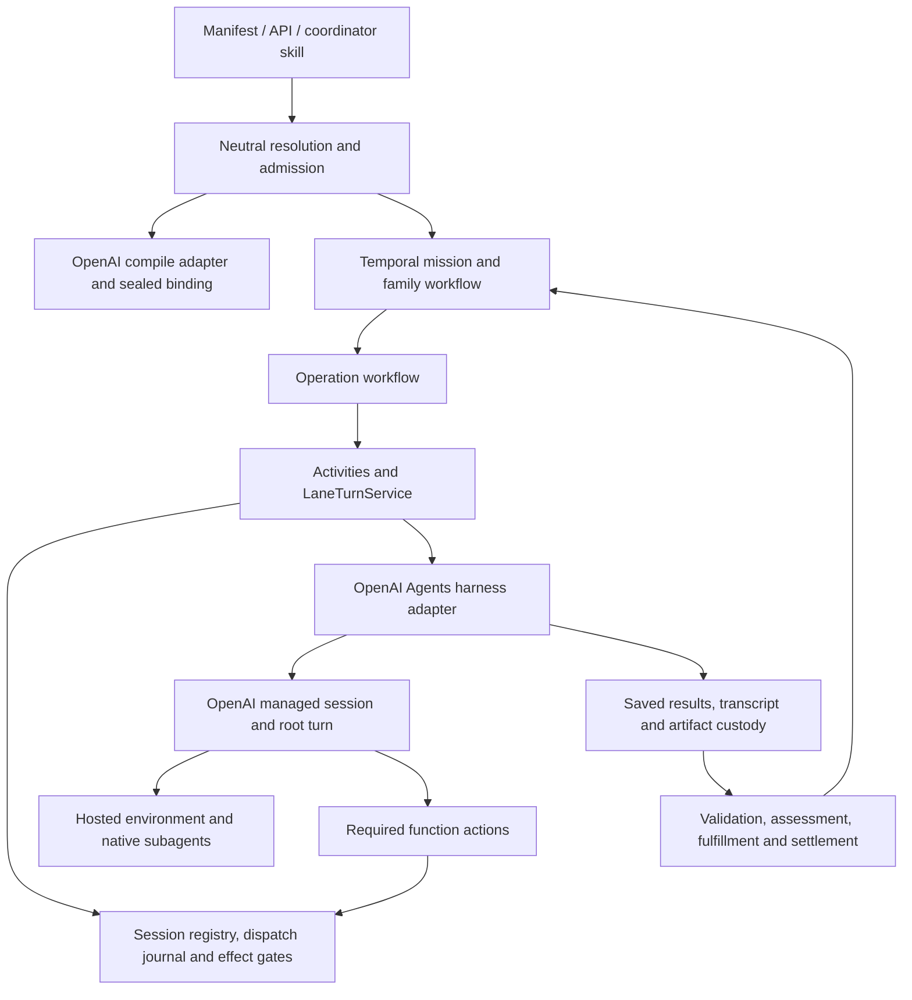

# OpenAI Agents API: workflow architecture projection

**Status: draft, 2026-10-30.** Architecture only. No runtime implementation, deployment,
paid probe or provider qualification is established by this document. Read the accompanying
[provider evidence](OPENAI-AGENTS-API-SURFACE-2026-10-30.md) for dated facts and uncertainties.

## 1. Goal, authority and starting state

Owner direction, 2026-10-30: "architect Goal Directed and Stage Graph lifecycle with openai
agents api"; "Take inspiration from how we did it with deep agents"; finish this API before
other OpenAI products. The owner authorized writing under platform and a GPT-6.1 Sol research
subagent. This projection closes the architecture-discovery gap; implementation and remote
recovery/fork qualification remain the next work. This is an explicitly requested exception
to the earlier Deep Agents-first prioritization, not a release of Sprint OC proof gates.

The accepted general specification, workflow annexes and output-contract annex remain
authoritative. ADR-0063 supplies the configuration/resolution seam; ADR-0057 and the precise
fork implementation supply family-position semantics. ADR-0052/0053/0057 are still marked
**proposed** even though related machinery exists. This proposal does not promote those ADRs.

### 1.1 Design position

Use the existing `codex_agents` profile and `adapters/openai_agents` package. Display the
product name **OpenAI Agents API**; do not rename persisted lane identities in this work.
The API harness always runs at OpenAI. Its environment can be `none`, `openai_hosted` or
`self_hosted`; the latter relocates tools/compute, not the managed harness. First qualify
`openai_hosted`; design `none` explicitly, with its different creation semantics. Application
workers, function handlers, artifact storage, ingress and Temporal must be deployed remotely
for the complete path to operate with the owner's laptop off.

**Mission semantics can be cohesive without pretending provider state is identical.**
Keep four separate records: mission/family state; operation settlement state; provider
session/turn state; environment state. A normalized observation links them, but never
replaces their distinct authorities.

### 1.2 Inspected baseline

Source checkout: `sprint-oc`, `e0ff5054eb0b8c3005b33c60fcb15e5eea7c8737`, clean at inspection.
These are source observations, not tests run in this design session.

| Existing source | What exists | Gap this design addresses |
| --- | --- | --- |
| [lane.py](../../../src/mission_control/adapters/openai_agents/lane.py), [describe.py](../../../src/mission_control/adapters/openai_agents/describe.py) | Describe-only compile registration; StageGraph/GoalDirected declarations; qualification false | Full pure compile and binding/rebind; per-field capability receipts and accurate runtime claims |
| [client.py](../../../src/mission_control/adapters/openai_agents/client.py) | HTTP/SSE client, `agents=v1`, wire shapes labelled openai 3.29.0; sessions, turns, items, artifacts, templates, vaults | Current schema verification; typed file/settings/subagent/trace operations and recovery guarantees |
| [harness.py](../../../src/mission_control/adapters/openai_agents/harness.py) | Shared remote-session base; root-turn filtering, dispatch reconciliation, subscribe/read history, cancellation and custody | Durable cross-operation session binding, explicit state vectors, control races and complete evidence capture |
| [pack.py](../../../src/mission_control/adapters/openai_agents/pack.py), [prepare.py](../../../src/mission_control/adapters/openai_agents/prepare.py) | Digest-keyed agent/template/vault preparation and hosted bundles; `AgentSpec.multi_agent: Literal[False]` | Broader typed configuration, per-attempt files, output schema, lifecycle-aware credential revisions |
| [tools.py](../../../src/mission_control/adapters/openai_agents/tools.py) | Root function actions, governed effects, result recheck, artifact/publishing handlers | General output-submission integration and pending-action recovery across session loss |
| [operation.py](../../../src/mission_control/adapters/temporal/workflows/operation.py) | Bounded `lane.turn` segments; waits, cancellation, continuation and saved-result settlement | Reuse these boundaries; provider timing must not become workflow scheduling |
| [cognition_points.py](../../../src/mission_control/domain/execution/cognition_points.py) | `session_cursor` already exists; shared point/index contracts | Honest OpenAI point capture and history read fidelity |
| [cognitive_seed.py](../../../src/mission_control/application/recovery/cognitive_seed.py) | Exact cognitive seed requires `CheckpointPoint`, seedable evidence and R3 | A separate reconstructed seed path; do not disguise an OpenAI turn as a LangGraph checkpoint |

### 1.3 Decisions proposed, not silently accepted

| ID | Recommendation | Reason / alternative |
| --- | --- | --- |
| OA-D1 | Temporal owns all mission schedules; no native automation tool in governed sessions | Native automation can dispatch outside admission, pause and budget fences |
| OA-D2 | Stage activations isolate sessions; GoalDirected may reuse an executor session within one configuration/session generation | Preserve explicit transfer, independent verification and controlled continuity |
| OA-D3 | Native delegation is a bounded provider-internal option; specialists requiring their own grants/configuration use separate MC operations/sessions | Native children share filesystem and cannot call application function tools |
| OA-D4 | Offer R1 reconstructed forks; qualify R2 only for a complete captured workspace scope; refuse R3 | No public selectable checkpoint/fork API was found |
| OA-D5 | Expose cooperative steering only with its actual race semantics; retain queue and cancel/replace as distinct operations | Active input steers, idle input starts another turn; no silent fallback |
| OA-D6 | Fresh session for tools/instructions/schema/multi-agent changes; later-turn model changes require a receipted revision | Provider session update is narrower than saved-agent configuration |
| OA-D7 | Keep current wire client, isolate schema/version upgrades behind it | Avoid unrelated SDK replacement; evaluate a generated API client separately if it reduces drift |

## 2. Module map

Use the repository's architecture-projection method. A small public surface hides provider
details; provider-neutral application ports remain the only route into that surface.

| Module | Layer / interface | Hides | Refuses |
| --- | --- | --- | --- |
| `openai_agents/compile.py` (new) | Adapter: `compile`, `project` implements `LaneAdapter` | Configuration translation, feature support, exact tools, skills, schema, environment plan | Required unsupported capability; uncontrolled scheduling; incompatible isolation |
| `openai_agents/binding.py` (new) | Adapter: lane binding/rebind registration | Frozen options plus live scope, unit, generation and context manifest | Digest drift, cross-scope reuse, stale revision |
| `openai_agents/session_runtime.py` (new) | Adapter: `prepare`, `dispatch`, `reconcile`, `control` | Native session/turn/environment coordination and resource correlation | Ambiguous ownership/dispatch; stale target; unsupported controls |
| `openai_agents/environment.py` (new) | Adapter: `materialize`, `capture` | Hosted inputs, template reuse, readiness, artifact manifests | Unsafe/colliding paths, incomplete required inputs, unproven full snapshot |
| `openai_agents/inspection.py` (new) | Adapter: history and point capture | Saved root/child items, bounded capture, gaps, lineage and available state | Fabricated internal state or item-level workspace history |
| `openai_agents/client.py`, `frames.py` | Adapter internals | Native schemas, routes, event parsing, pagination and typed errors | Unknown terminal mapping; malformed ownership fields |
| `openai_agents/harness.py` | Existing `AgentHarness` façade over runtime | Harness requests and closing facts | Provider completion promoted directly to mission acceptance |
| `application/execution/provider_sessions.py` (new) | Application: session registry and repository ports | Logical scope/role/generation to native-session binding; compare-and-swap acquisition | Multiple active writers; reuse across isolation/configuration boundaries |
| `application/recovery/reconstructed_seed.py` (new) | Application: portable fork-seed saga | Rehydration from sealed transcript/context/artifacts and validation | R3 request, missing scope, post-cut evidence, source mutation |
| `adapters/remote_session/*` | Existing shared mechanics | Stream handling, dispatch, retention, usage and custody patterns | Provider-specific policy in generic loops |

Do not duplicate `LaneTurnService` ownership, dispatch journal, Stop Fence, effects or
settlement inside the new runtime. Its native methods are called under those guards. The
session registry supplies cross-operation identity and a session-wide writer lease; the
existing execution lease still fences individual operation workers. Acquisition/renewal
order is session then operation, with no inverse lock ordering.

## 3. Projected file changes

Paths below are relative to the repository; **none of these runtime changes is made here**.

```text
src/mission_control/
  adapters/openai_agents/
    compile.py, binding.py       new: pure compile and lane-owned rebind
    session_runtime.py           new: provider lifecycle coordination
    environment.py               new: hosted materialization and capture
    inspection.py                new: saved evidence, points, reconstruction adapter
    client.py, frames.py          change: current typed provider surfaces
    pack.py, prepare.py           change: configuration plans, schema, credential revisions
    harness.py, tools.py          change: façade and output/required-action integration
    lane.py, describe.py          change: real registration and evidence-backed capabilities
  application/execution/provider_sessions.py  new: neutral binding/lease repository port
  application/recovery/reconstructed_seed.py  new: explicitly reconstructed seed saga
  adapters/postgres/lanes/provider_sessions.py new: scoped CAS binding repository
  adapters/temporal/hosted_lane_composition.py change: wire runtime and dependencies
```

Additional shared edits must be justified at implementation by consumers on more than one
lane or an existing neutral contract. In particular, update the cognition-point record with
an optional immutable capture reference rather than adding OpenAI fields to family state.
Add neutral receipt/storage contracts alongside the session registry. Use the existing
bootstrap registries and ingress handlers; do not create a second webhook framework.

## 4. Interfaces and sealed contracts

The following Python signatures are a proposed interface sketch, not generated public API
or runnable code. Referenced existing types retain their current definitions. Supporting
new records are defined below and are provider-neutral unless in the adapter package.

```python
class OpenAIAgentsCompileAdapter:
    @property
    def profile(self) -> str: ...  # codex_agents

    def compile(
        self, agent: AgentConfiguration, lane_options: Mapping[str, Any]
    ) -> tuple[SealedLaneBinding, MaterializationReceipt]:
        """Pure translation; refuse unsupported required semantics before I/O."""

    def project(
        self, agent: AgentConfiguration, repo_view: RepoView | None
    ) -> HostProjection | None:
        """Describe bundle materialization without provisioning resources."""

class ProviderSessionRepository(Protocol):
    async def acquire(
        self, key: SessionScope, *, owner: str, expected_version: int | None
    ) -> SessionBinding:
        """Acquire a scoped writer lease or return a typed ownership conflict."""

    async def bind(
        self, key: SessionScope, *, lease_epoch: int,
        expected_version: int, native: NativeSessionBinding
    ) -> SessionBinding:
        """Persist a reconciled native identity using compare-and-swap."""

    async def record_observation(
        self, key: SessionScope, *, lease_epoch: int,
        expected_version: int, observation: ProviderObservation
    ) -> SessionBinding:
        """Persist observation references, never infer family acceptance."""

class AgentsSessionRuntime:
    async def prepare(self, request: PrepareRequest) -> PreparedSession: ...
    async def dispatch(self, request: SendTurnRequest) -> TurnHandle: ...
    async def reconcile(self, request: ObservationRequest) -> ProviderObservation: ...
    async def control(self, request: ProviderControlRequest) -> ControlOutcome: ...

class AgentsEnvironment:
    async def materialize(
        self, request: MaterializationRequest
    ) -> EnvironmentReceipt: ...

    async def capture(self, request: CaptureRequest) -> CaptureReceipt: ...

class ReconstructedSeedService:
    async def prepare(self, request: ReconstructedSeedRequest) -> ReconstructedSeedPlan: ...
    async def apply(self, plan: ReconstructedSeedPlan) -> ReconstructedSeedReceipt: ...
```

| Record | Required contents / invariants |
| --- | --- |
| `SessionScope` | Installation, application, tenant, run, family activation, role/owner unit, logical session generation, lane, session-compatibility digest. Stage scope includes cycle/activation. No reuse by prompt similarity. |
| `SessionBinding` | Scope, binding version, owner/lease epoch/expiry, native binding, latest observation ref and active operation. One writer across all units that reuse a session. |
| `NativeSessionBinding` | Provider project/auth route reference, session ID, environment ID if any, configuration revision, resource/manifest refs. Secrets excluded. |
| `ProviderObservation` | Observed-at time, raw session/environment/turn statuses, root turn ID, required action identities, immutable item/capture refs, completeness/gaps, usage observation. Adapter-private wire payload stored separately. |
| `ObservationRequest` | Scoped binding, exact root turn, expected lease epoch, item inventory cursor, bounded scan budget. A live event cursor is not a replay cursor. |
| `ProviderControlRequest` | Scope, command ID, kind (`queue`, `steer`, `cancel`), expected session and root turn, command revision, sealed input digest. |
| `ControlOutcome` | Delivery stage (`queued`, `submitted`, `observed`, `stale_target`, `in_doubt`, `unsupported`), native refs, evidence ref, whether a successor turn was created. Do not call 202 applied. |
| `MaterializationRequest` / `EnvironmentReceipt` | Binding/input manifest, exact destination/content digests, size limits, credential declaration revisions, environment/template IDs, readiness/setup evidence and missing items. |
| `CaptureRequest` / `CaptureReceipt` | Scope, terminal turn, boundary/cut, workspace scope, artifact manifest, per-file bytes/digests and provenance, gaps, read/restore fidelity. |
| `ReconstructedSeedRequest` / `Plan` / `Receipt` | Source run snapshot and capture, target run/unit, requested minimum R0/R1/R2, admitted context patch, selected evidence and exclusion manifest, new session/materialization receipt, losses, idempotency and completion status. Never copies pending tool calls. |

Proposed refusal names: `session_binding_conflict`, `provider_dispatch_in_doubt`,
`provider_state_missing`, `provider_snapshot_incomplete`, `provider_control_stale_target`,
`provider_capability_unsupported`, `provider_configuration_changed`,
`provider_reconstruction_incomplete`. Map to the existing shared error envelope and retry
classification; do not create separate transport-specific public errors.

### 4.1 Configuration that must be sealed

Record model/profile and wire version; instructions and output schema digests; tools and
MCP routes/allowed tools; skill/plugin versions and bytes; environment mode/template/packages;
network policy; inputs and destinations; vault references plus credential revisions; native
delegation settings; output obligations; retention and session reuse policy; execution bounds;
trace requirement; control/restore requirements. Materialization receipts classify every
requested field as native, emulated, degraded or unsupported. Required unsupported fields fail
before dispatch. Unknown provider options fail validation instead of disappearing.

Use separate digests: the full compiled/attempt binding includes its input manifest; the
session-compatibility digest covers invariant instructions/schema/tools/environment/grants/
credential revisions and excludes iteration-specific inputs. Each dispatch seals its own input
digest. Model/effort/tier are recorded in a separate settings revision: an admitted update
changes that revision through a journaled idle-boundary update and readback, while retaining the logical
session scope. An incompatible change advances logical session generation and creates a new
native binding. Never silently rebind a different configuration to an existing scope.
The remote update and local receipt are not one atomic transaction: an uncertain response
requires settings readback before the next dispatch.

Saved agents and templates are immutable by digest in MC. Provider session creation overrides
replace whole supplied objects/arrays; compile complete effective fields, never rely on a
deep merge the provider does not perform. Session updates are a different, limited API.

## 5. Dependencies, identities and lifecycle



Temporal workflow code imports neutral contracts and schedules activities. It makes no OpenAI
calls and reads no provider wire payloads. Application services use ports; bootstrap wires
adapter implementations. The OpenAI runtime owns mapping, not mission decisions.

Identity chain: run -> family activation -> stage/cycle or goal iteration/role -> operation
attempt -> execution generation -> harness execution -> provider session -> root turn ->
item/action/subagent. These are relationships, not interchangeable IDs. Temporal Run ID changes
on Continue-As-New; it must not become the logical dispatch or session identity.

| Provider observation | MC interpretation / action |
| --- | --- |
| Session starting / environment pending | Preparation remains pending, bounded by deadline; no readiness claim |
| Environment ready/connected | Compute availability only; verify required input/setup receipt |
| Session idle | Eligible to submit; not a completed operation |
| Root turn in progress | Observe exact turn; renew leases; progress does not release dependencies |
| Required action | Persist action intent; execute or wait for Human Task under grants; exact identity recheck before result |
| Root turn completed | Capture durable result/items/artifacts, then run normal output and settlement pipeline |
| Root turn failed/cancelled | Preserve partial evidence and liability; classify retry/recovery; never infer rollback |
| Child turn completed | Subordinate evidence only; root operation stays open |
| Environment suspended/disconnected | Independent availability observation; reconcile provider session and turn; no fabricated pause/checkpoint |
| Session failed / environment expired | Recover history/artifacts where available; determine loss and propose admitted fresh-session continuation |
| Unknown or conflicting state | Persist raw observation and gap, re-read under bounded policy; fail/park typed, never guess success |

### 5.1 Durable dispatch and recovery

1. Admit operation and reserve budget. Acquire session-wide and operation ownership; resolve
   scope, configuration and generation; persist intent before remote mutation.
2. Create/reuse immutable resources. Journal session creation separately from initial input.
   Recover lost create responses by exact metadata correlation; an empty eventually consistent
   list is not authoritative non-receipt. Multiple matches are an incident, not an arbitrary pick.
3. For hosted sessions, prepare without initial work when supported; attest required inputs
   before business input. `environment: none` requires initial input: compile a combined
   create-and-initial-input dispatch and journal it as such, never send the first task twice.
4. Open SSE before input, buffer while fetching authoritative records. Persist one input
   idempotency key and payload digest per logical submission. Retry only the same payload/key
   under the provider's verified retention guarantee; unknown acknowledgement parks in doubt.
5. Correlate the exact root turn. Persist the pre-send root inventory and observed new identity;
   do not rely on process memory after a crash or guess among multiple turns. Known protocol
   acknowledgement and root ownership must agree. Keep one writer and prohibit automations.
6. Observe in bounded `lane.turn` segments. On disconnect, reopen/buffer, read session, pending
   actions and all relevant paginated turn items, then merge by item ID/revision/finality. Item
   creation order is not completion order: revisit previously unfinished items. Never promise
   replay of missing deltas. Scope dedupe by session/turn/item, not event text alone.
7. Read exact root terminal record, capture final result once, and settle saved output. A
   persistence or fulfillment retry must not dispatch cognition again. Required actions and
   effects use native call identity and durable receipts, not argument equality.
8. On worker takeover, fence the old owner and reload all records. On Temporal Continue-As-New,
   preserve active operation/session/turn, command IDs, input keys, cumulative budgets/deadlines
   and reconciliation state. Rollover creates neither a new goal iteration nor provider session.

The provider may continue computing while a worker is down. Existing known sessions can be
reclaimed, observed and cancelled. Unknown session creation is an orphan-risk incident until
metadata reconciliation succeeds; local cancellation cannot prove remote quiescence.

## 6. Workflow sequences

### 6.1 StageGraph

`launch` -> neutral resolver -> frozen template -> StageGraph release decision ->
`StageGraphOperationPreparationService.materialize` -> sealed exact transfer -> operation
child -> `lane.turn` -> OpenAI root turn -> saved result/custody -> assessment/fulfillment ->
settled operation -> StageGraph reducer -> next eligible stages.

- A stage activation/cycle owns an isolated session by default. Concurrent stages never
  share a mutable provider session or workspace. Dependency inputs come from the sealed
  transfer plan, not a predecessor's unfiltered conversation.
- Internal tool loops and native children remain one bounded stage operation. They cannot
  release graph edges, create accepted obligations or bypass a graph-level review.
- A retry of observation reattaches. A new business attempt has a new attempt identity and
  admitted reuse/reconstruction policy. A revisit is a new cycle with a new input contract.
- Graph joins still select exact accepted outputs, including any/quorum rules. Late provider
  artifacts cannot alter sealed consumer inputs; they become later evidence only.
- A semantic fork uses existing dependency closure and start-position rules. Reused stages
  reference immutable accepted evidence. Re-executed stages get new sessions; upstream native
  sessions are not cloned or mutated.

### 6.2 GoalDirected

`admit goal revision` -> prepare executor iteration -> resolve executor session scope ->
bounded root turn -> submit/capture outputs -> assessment and current-set update -> prepare
independent verifier -> verifier root turn -> verification/fulfillment -> convergence reducer
-> accept, wait, fail, or next iteration with exact current/repair/history inputs.

- Preserve the existing separation of iteration, agent-run count, execution generation,
  session generation and technical workflow segment. Native turns are mapped to role units,
  not counted as goal iterations automatically.
- Continuing-executor policy may reuse a healthy session only while logical session generation,
  session-compatible configuration, grants, project and workspace match. A neutral persistent binding is required:
  a common MC `session_id` string alone does not prove native-session reuse across operations.
- Each verifier uses a fresh independent session and the sealed candidate/evidence view. It
  does not inherit executor private conversation, hidden rationale or writable workspace.
- If the selected transfer policy requires a clean or reduced context view, create a fresh
  executor session. Retained provider history cannot promise removal of prior information.
- Automatic provider compaction is context maintenance, not a new iteration or an MC transfer
  receipt. Require a progressive report/continuing progress note at governed boundaries; MC
  retains its authoritative current accepted set outside the provider conversation.
- Tools/instructions/schema/delegation changes require a new native session. Model-only changes
  may use the documented session update only at a fenced boundary and under a new MC revision,
  with readback recorded before the next message. No unreceipted mutation of frozen configuration.
- Expiry or failed session triggers a separate continuation saga: capture available evidence,
  seal transfer, validate protected facts and obligations, provision replacement, validate
  delivery, record lineage, then dispatch unfinished work. Never mark this an exact resume.
- A rejected or malformed verifier answer follows existing typed failure/convergence rules;
  do not retry transport indefinitely to repair a model's invalid answer.

### 6.3 Output contracts

Project the role's schema into `agent.text.format` where supported and bounded. A native
structured response is syntactic evidence, not acceptance. The canonical submission act and
output envelope remain MC-owned. Expose that act through a registered root function tool;
alternatively use the existing host-mediated final-result ingestion with attributable origin.
Both paths must converge on one idempotent submission identity, not submit two final reports.
Map actual schema compatibility before launch; refuse required unsupported schemas.

Download artifacts by exact session, terminal turn and path/version into application custody;
validate digest/media/size and record missing required artifacts. Tool success, published file,
provider turn completion, output validity, assessment, fulfillment and mission acceptance stay
separate. Partial output survives failure with a partial disposition. Do not settle a missing
required output merely because OpenAI reports a completed turn.

### 6.4 Controls, deadlines and pending effects

| Control | Proposed semantics |
| --- | --- |
| Queue instruction | Persist mailbox entry; deliver only at the selected MC boundary, not immediately to an active provider turn |
| Steer | Journal command, validate current root turn and ownership, submit input; report accepted/observed separately. Native input has no expected-turn compare-and-swap. Re-read detects a completion race and unintended successor turn but cannot prevent its effects. Required exact-target semantics remain unsupported. |
| Interrupt and inject | Explicit cancel-and-replace path until a separately qualified cooperative mode is selected. Preserve original closing evidence before replacement. |
| Pause | Stop new dispatch at an MC boundary. A running provider turn may continue unless policy explicitly cancels it. Do not display hard-paused compute. |
| Resume | Release MC boundary wait; continue only a valid idle session or perform admitted replacement. Not checkpoint restore. |
| Cancel | Set Stop Fence first, journal cancel, observe exact root terminal state and reconcile effects/usage. Session-level cancel may race; exclusive ownership and no provider automation are prerequisites. |
| Budget/deadline | Govern admissions and wall-clock waits; cancel when exhausted; settle incurred usage separately. Unknown costs are not zero. No hard mid-turn spending guarantee absent a verified native cap. |

Subagent or shell effects may already have occurred when cancellation arrives. Tool handlers
check scope/revision/Stop Fence immediately before their effect and before result delivery.
Effect committed but result delivery lost is reconciled from the effect receipt, not repeated.
Long Human Tasks live durably in MC; if the session expires, abandon the obsolete native handle
with evidence and reconstruct safely. Never deliver an old call ID to a replacement session.

## 7. Environments, files, vaults and delegation

### 7.1 Hosted input and output pipeline

1. Compile a content-addressed input manifest from admitted context slots, skills and assets.
   Use absolute `/workspace/...` destinations; validate traversal, symlinks, collisions and sizes.
2. Upload small inputs inline; use Files API IDs for larger inputs within current documented
   bounds. Template contents are reusable configuration; per-operation evidence is attached
   to the session, never placed in a globally reused template accidentally.
3. `environment.files` installs initial inputs. After connection, environment Files API adds
   files. It does not overwrite existing paths: late inputs use versioned destinations and a
   new manifest. Prefer a new session at a semantic boundary when exact replacement is needed.
4. Setup and input verification precede business work. A setup command failure blocks readiness.
   Hash verification performed inside the sandbox is provenance from that environment, not
   independent content judgment. Archive the original uploaded bytes in MC custody.
   Setup commands run on environment creation, not after later file uploads. Reused environments
   need a separate post-upload verification receipt before consuming new inputs. An environment
   of `none` has no filesystem receipt; validate its text/image input at combined creation instead.
5. Agent deliverables go under `/workspace/outputs`. At completed turn boundaries, list and
   download exact published artifacts and save custody receipts. Artifacts survive sandbox
   expiry; copy required data before deleting the session. Session/template/file/vault cleanup
   has separate ownership and reference counting; ending one operation must not delete a
   GoalDirected session still leased to the continuing executor.

Input files do not have to be model-generated. MC can send exact existing bytes directly.
An environment template is not a filesystem snapshot. Provider-published artifacts cover the
output directory, not arbitrary working files. A reconstructable workspace requires an explicit
bounded export of its declared scope; absence of files outside that scope must remain visible.

### 7.2 Vaults

Vaults hold authentication material, not agent memories or workspace snapshots. Keep organization
API keys in trusted workers. Vault delivery provides placeholders substituted by the hosted
egress proxy only at allowed HTTPS destinations; it is not a way for sandbox code to read a
secret for arbitrary local signing. Network admission and credential allowed-host policy both
must permit the call. MCP credentials follow their documented transport mechanism.

Reuse the Secret Broker; persist references and credential revisions, never secret values.
Credential rotation for environment-variable delivery requires a new session; the current
preparer's declaration digest must not conceal a changed secret version. Deleting a vault
credential is not revoking the upstream token or stopping a running session. Exact tenant,
project and purpose scope applies to resource reuse. No publication credential in the sandbox.

### 7.3 Multi-agent

Expose typed `enabled` and `max_concurrent_subagents` native controls and record the effective
values; do not rely on the current documented default of six. Native children have their own
context but share the environment and inherit supported MCP/credential/tool configuration.
They cannot call application function tools. The root must perform MC output submission and
governed effects through its handler. Native child histories are observable separately;
coordination stream messages may omit content.

Do not equate a native child to a Deep Agents seeded specialist with independent tools, model,
grants or sandbox. Required specialist isolation routes to MC-managed child operations or linked
missions with their own sessions. Native external subagent create/message/interrupt controls
are not established by the inspected REST reference; harness coordination items alone do not
prove an application control endpoint. Required per-child controls must be refused until mapped.

Read-only native delegation is the first qualification target. Enabling writable shared-sandbox
delegation needs collision/recovery tests and a declared sharing policy. Built-in shell/file tools
are not intercepted by MC function-tool approvals; missions requiring every shell/file action
to pass an MC gate are unsupported on this placement. A remote MCP tool with writes must itself
enforce the same grants/effect authority or remain unavailable.

## 8. Inspection, recovery and fork fidelity

Deep Agents supplies native checkpoint state, channels and lineage through
[time_travel.py](../../../src/mission_control/adapters/deep_agents/time_travel.py). OpenAI
supplies durable items, turns, session metadata and published artifacts. These are inspectable
evidence, not equivalent internal snapshots.

| Level | OpenAI target | Explicit limit |
| --- | --- | --- |
| R0 | Sealed MC context packet | No conversation or workspace restoration claim |
| R1 | Packet plus immutable transcript to a captured turn boundary | Missing stream deltas/hidden state disclosed; history reconstructed in a fresh session |
| R2 | R1 plus complete captured files for declared workspace scope | Requires verified capture at that cut; published outputs alone are not the whole workspace |
| R3 | Unsupported | No documented selectable native checkpoint/fork endpoint; private suspended-environment checkpoint does not qualify |

R1 preserves the captured transcript as an MC artifact. The native input surface accepts user
text/images, not arbitrary historical assistant/tool items preserving roles and call IDs.
Reconstruction therefore supplies clearly labelled historical evidence and summaries as input;
it does not restore native conversation state. For R2, root completion alone is insufficient:
root, writable native children and other environment activity must be quiescent. The receipt
requires complete declared-scope inventory and captured bytes, not just paths and claimed hashes.

First expose read-only `session_cursor` points at root turn boundaries. A captured point stores
session/turn and MC unit coordinates, manifest digest, observation time, final item inventory,
raw/normalized status, gaps and fidelity. Read historical captures, not today's mutable session
as if it were yesterday's state. Intermediate observations may be inspected but are not advertised
as exact reconstructable cuts. Never reuse the `checkpoint` discriminator for an OpenAI item.

### 8.1 Reconstructed fork saga

1. Use `SemanticForkService` for admitted snapshot, stage dependency closure, reused evidence,
   family start position, new budget and lineage. Preserve the source run and session.
2. Select an immutable boundary capture; reject missing required input or post-cut artifacts.
   Forks from active work use an explicitly historical settled cut or wait for quiescence.
3. Seal a `ReconstructedSeedPlan`: selected transcript, current accepted set, obligations,
   feedback, files, patch and omissions. Historical calls are evidence, never executable
   pending actions; credentials, approvals and active children are not copied.
4. Allocate a fresh provider session/environment, upload selected bytes, validate materialization,
   then record the seed receipt. Persist saga progress; retry by request identity without creating
   another session or starting work twice. Launch is blocked until seed preparation completes.
5. Resume the derived family at its admitted position. The forked GoalDirected executor gets
   reconstructed context; the verifier is fresh. Reused stages retain source-result references;
   all newly executed effects carry new attempt identities and current authorization.

Add a distinct reconstructed-seed request path to the common fork contract; keep current R3
`cognitive_seed` validation unchanged. `read_as_of` can use the existing time-travel registry,
but the current `collect_points` checkpoint-oriented inputs need a neutral capture-query port
or a versioned extension. Do not manufacture saver IDs to fit OpenAI history into that method.
The interface must disclose requested versus achieved level and omitted state. No automatic
downgrade when a caller requires R2/R3.

### 8.2 Recovery classification

| Failure | Next action | Must not happen |
| --- | --- | --- |
| SSE disconnect / worker loss | Reclaim lease, reopen/buffer, read session/items/actions, continue observing | Resubmit work solely because stream closed |
| Lost input acknowledgement | Same logical key/payload under verified dedupe guarantee; otherwise reconcile/park | New key for the same uncertain input |
| Completed provider turn, DB/fulfillment outage | Settle saved result, retry bounded persistence | Another model call |
| 429 / transient service failure | Honor Retry-After, bounded durable wait; inspect accepted work first | Reset deadline/budget on each retry or rollover |
| Failed turn, reusable idle session | Apply MC attempt policy, submit only admitted unfinished work | Treat idle as successful or redo committed effects blindly |
| Failed/expired session or lost environment | Capture surviving evidence, admitted replacement and new generation | Claim exact restoration or silently drop required files |
| Unknown outcome after cancel | Reconcile until bounded deadline, then explicit incident with liability | Claim cancellation rolled back tools or closed all cost |
| Auth/config/schema fault | Typed refusal; corrected configuration/revision | Unbounded activity retries |

## 9. Data, receipts, webhooks and tracing

### 9.1 Storage projection

Reuse `harness_execution.native_identity` for the existing dispatch journal and per-execution
ownership, native frames/transcript stores, output submissions, artifact custody and existing
invocation settlement. Do not store full transcripts in Temporal history or metadata fields.

Add neutral `provider_session_binding` storage for durable cross-operation session reuse:
scoped primary identity, lane/profile and configuration digest, logical role/session generation,
native identity/project references, owner epoch/lease, active operation, version and observation
reference. Enforce a unique logical scope and one active writer; bind all queries to application
and tenant. Native project/session lookup supports authenticated webhook routing, not authority.

Add immutable `provider_state_capture` manifests (bytes in artifact storage, scoped index row
with digest, source session/turn, cut, workspace scope, gaps/fidelity). Cognition-point rows link
to these captures. Reconstructed seed progress must be persisted in the fork saga, including
created resource IDs, phase and receipt, so a worker restart cannot duplicate provisioning.

Implementation must add a new ordered migration in the db-contract package and bump its
component release; choose the next number from the then-live migration head. No version is
reserved and no migration executed by this architecture task. Review existing JSON extension
fields before adding columns, but do not leave the cross-operation binding process-local.
Migration acceptance requires application/tenant isolation, unique-scope races, CAS takeover,
and restart/resume tests on disposable PostgreSQL.

### 9.2 Webhooks

Verify signature against the raw request body, enforce replay policy and deduplicate delivery
IDs, then durably enqueue a scoped reconciliation wake before acknowledging. Resolve the
resource against trusted stored project/session bindings; unknown resources are quarantined.
Webhook payload is a hint, not result or authority. Map `agent.session.action_required`
(webhook) separately from `agent.session.requires_action` (stream).

Wake the same operation reconciliation path used by polling/SSE. Handle duplicate, out-of-order,
late and missing webhooks. Root turn failure need not produce session-failed webhook, so polling
and saved-turn reads remain necessary. Continue-As-New must preserve a stable routable workflow
identity. Session deletion is not a reliable termination notification or external compute cleanup.

### 9.3 Observability and accounting

Expose mission/family/unit/attempt/session/root/child/artifact IDs as linked identities in the
existing transcript and lineage graph. Distinguish provider timestamps from observed-at time,
live event sequence from durable item identity, and stream gaps from absent events.

Provider traces are supplementary: completed-turn export can lag, is paginated OTLP JSON,
and may require organization/project enablement. Do not make settlement depend on traces unless
the mission explicitly requires them. Record availability/denial separately from an empty trace.

Usage is versioned observation: null is unknown; turn completion does not freeze all accounting.
Reconcile late updates without double charging. Declare whether each total is root-only,
child-only or session aggregate; do not add overlapping totals. Cached input and reasoning
tokens are subsets, not additional tokens. Price estimates, provider usage and billed cost
are separate fields. Enforce a conservative reservation/reconciliation policy for unknown cost.
Session usage is an aggregate; agent trace spans exclude child-agent usage. Select a qualified
session-delta basis or a nonoverlapping set of attributed turn observations, never session plus
root plus child totals. Do not assert that these sources reconcile exactly before the live probe.

### 9.4 Scheduled work and documentation upkeep

Native automations are capable but deliberately excluded from governed sessions in this first
adapter. Their invocation completion means delivery, and they can outlive the operation that
created them. A native schedule directly targeting a governed session is a second dispatcher.
Detect such drift rather than adopting its turns as authorized work. Do not delete unrelated
project schedules automatically.

Offer future scheduled work through an MC scheduling capability backed by Temporal. The same
mechanism runs provider documentation maintenance remotely: fetch official reference/changelog
and SDK schema versions; compare saved baselines; produce a cited change proposal; classify
compatibility, migration, tests, deprecation date and affected skill guidance. Apply only under
a versioned owner acceptance policy. Documentation discovery does not promote support or
qualification. Supersede the old proposal's local-cron-first option for this new remote path
only when the owner accepts the deployment design. No schedule is created by this document.

## 10. Seams, proof plan and implementation order

All paths here are **proposed tests**, except already existing suites explicitly identified.

| Slice / seam | Tests and decisive evidence | What remains unproven |
| --- | --- | --- |
| A: compile/binding | `tests/unit/openai_agents/test_compile.py`; extend `tests/conformance/lanes/`: exact schema/config, unsupported field refusal, no-family-provider imports, attempt rebind | Real provider acceptance |
| B: session coordination | `tests/unit/openai_agents/test_session_runtime.py`: lost create/send, ambiguous matches, restart without in-memory anchors, duplicate/late terminal events, child-root separation | Remote service timing |
| C: durable ownership | `tests/integration/openai_agents/test_session_binding.py`: PostgreSQL CAS races; stale worker fenced; two Goal units serialize; tenants cannot share | Production load |
| D: hosted materialization/output | `tests/unit/openai_agents/test_environment.py`: path/size/collision, template vs input, exact artifacts, missing required output, expired environment | Actual upload/publication behavior |
| E: workflow integration | `tests/integration/temporal/test_openai_agent_families.py`: StageGraph fan-out/join and failed producer; two Goal iterations with independent verifier; model invalid output; saved settlement retry without cognition | Live model/provider correctness |
| F: controls/recovery | Fake-provider + real Temporal crash before/after remote submit, pending Human Task, committed effect/lost result, cancel race, budget exhaustion, Continue-As-New | Hosted cancellation latency and final accounting |
| G: inspection/forks | `tests/unit/openai_agents/test_inspection.py` and integration fork tests: exact cut, no later data, R1/R2 evidence, R3 refusal, source unchanged, failed seed blocks launch, seeded retry creates once | Whole-workspace reconstruction on provider |
| H: ingress/accounting | `tests/unit/openai_agents/test_webhook_reconciliation.py`: signature/replay, wrong tenant, missing failure webhook, duplicate usage, delayed traces | Account trace permissions and billing reconciliation |
| I: live qualification | Explicitly authorized remote fixtures for input files, root function tools, native children, expiry, cancel, reconnect, replacement and artifact custody; laptop-off test | No live claim before receipts |

Build A/B/C first, then D/E/F; G/H complete the lifecycle surface; I qualifies exact deployment,
model, wire version and placement. Every build slice needs its normal OVE work item before
runtime implementation. Initial proof should cover one StageGraph producer/consumer and two
GoalDirected iterations, then fault injection. Avoid testing only happy-path text completion.

### Decisions and probes still needed

- Research completed for public surfaces; no native fork endpoint found. Probe private
  suspension/expiry behavior only to qualify recovery, never to infer R3.
- Confirm OA-D1–7 defaults before implementation; design authorization is not acceptance of
  every proposed capability or policy.
- Pin the actual accessible API/SDK contract and account capabilities; 3.29.0 is the inspected
  code baseline, not a claim of latest compatibility.
- Qualify exact-target steering/cancel races and input idempotency lifetime. Until then preserve
  the existing cancel-and-replace contract and disclose unsupported stronger semantics.
- Verify usage aggregation across native children and full required file export at a quiescent
  boundary; refuse stronger fidelity if either remains ambiguous.
- Check output schema/tool-submission compatibility and general context materialization against
  the current output-contract annex during implementation; no alternate output authority.

### Coordinator skill projection

Extend the existing MC coordinator/router guidance when runtime support lands. Its procedure is:
describe the lane and actual qualification; select hosted/no-environment placement; preview the
effective configuration and capability receipt; declare output obligations, exact transfer,
session reuse and required restore fidelity; launch through normal admission; inspect the linked
mission/unit/provider records; choose queue, steer, cancellation or reconstructed fork using
their declared semantics. It must show a reconstruction's omitted state before dispatch and
never offer exact checkpoint restore merely because the provider describes private checkpoints.

The custom-script extension path stays behind the same admitted tools, scope and budgets.
For this phase, scripts configure/use Agents API only; Responses and Agents SDK integrations
remain separate later work. This projection does not advertise unimplemented skill commands.

## Appendix: alternative designs for the hardest seam

**One long-lived session per entire mission:** simple native context continuity, but concurrent
stages collide, verifier independence disappears, and workflow controls compete with a single
turn stream. Rejected as the default.

**Fresh session for every activity retry:** easy isolation, but repeats work after worker loss,
loses context, and confuses infrastructure retry with a new business attempt. Rejected.

**Chosen proposal:** durable logical session binding at the semantic role/activation level,
with bounded operation turns, journaled dispatch and separately recorded observations. Reuse
only where the workflow contract permits it; reconstruct explicitly when native state is lost.

## Conformance

Not built. This document is an architecture projection and evidence-backed proposal. Source
conformance, schema deployment and remote qualification remain unrun.

Documentation validation on 2026-10-30: `python docs/tools/check_docs.py` passed all seven
offline checks; `git diff --check` passed. GPT-6.1 Sol reviewed the provider semantics and its
corrections on compatibility digests, file verification, reconstruction fidelity, controls and
usage were incorporated. These checks establish document consistency, not runtime behavior.
