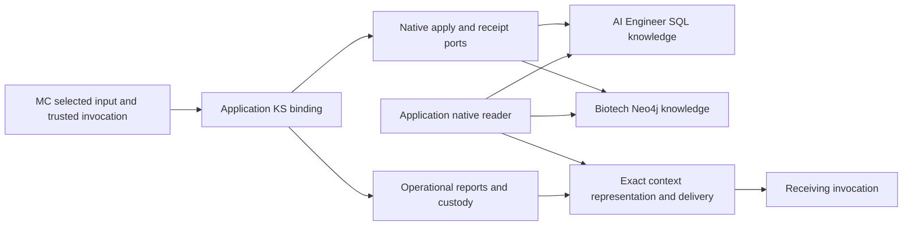

# Application ports: start here

Read this page, then **one** application card: [AI Engineer](SCHEMA-AI-ENGINEER.md) or
[Biotech](SCHEMA-BIOTECH.md). This is navigation and source evidence, not another specification.
[OUTPUT-CONTRACTS](../../../knowledge/output-contracts.md)
§§5–6 and 10 remain the target authority; [IMPLEMENTATION](IMPLEMENTATION.md) and
[PROOFS](PROOFS.md) own delivery and acceptance.

**The application port is a scoped service binding, not a copy of Mission Control into the knowledge
schema.** MC records who ran, what was submitted/selected and which effect or transfer settled. Shared
Knowledge Services (KS) owns operational reports, verification and permitted use in each application's
PostgreSQL. Native domain knowledge belongs to AI Engineer's SQL schemas or Biotech's Neo4j graph.
Those layers exchange authenticated origin, exact references/digests and receipts. Co-location in one
PostgreSQL database does not make them one authority or imply foreign keys between them.

## 1. Where the data lives

| Data | AI Engineer | Biotech | Owner / entrypoint |
| --- | --- | --- | --- |
| Mission lifecycle, outputs, effect journal, context selections/receipts | `mission_control` in `supabase-blue-ocean` | `mission_control` in `biotech-research-ingestion` Supabase | MC [app targets](../../../../deployments), [database package](../../../../packages/mission-control-db-contract/README.md) |
| Operational report revisions, assertions, verification runs/seals, use decisions, protocol/native effect records | Common `knowledge_verification` component in application PostgreSQL | Same common component in Biotech application PostgreSQL; not Neo4j | KS [host](../../../../../knowledge-services/packages/host/src/knowledge-operation), [component](../../../../../knowledge-services/packages/knowledge-db-contract/component) |
| Admitted entity, technical and source knowledge; native projections | AIDB `research`, `knowledge`, `corpus`, `evidence`, etc. | BKS graph entities, reports/assertions and Activity provenance | Application cards below |
| Large report/package bytes | Selected custody backend, outside the MC journal | Selected custody backend, outside the MC journal | KS exact read resolves and digest-checks custody; a database row alone is not readable content |
| Standalone Deep Agents checkpoints/store | `mission_control_runtime` on resolved saver DSN | Same schema on resolved saver DSN | [Settings](../../../../src/mission_control/bootstrap/settings.py), [saver](../../../../src/mission_control/adapters/deep_agents/persistence.py) |
| Agent Server and Temporal history | Separate persistence roles | Separate persistence roles | [ADR 0017](../../../../docs/adr/0017-agent-server-runtime-persistence-separate-database.md), [topology note](../providers/deep_agents/TOPOLOGY-NOTE.md) |

The owner's temporary topology is AI Engineer saver in application PostgreSQL and Biotech saver in
Docker. Source supports that arrangement, but this audit did not inspect running processes or live
databases. `MC_<PLANE>_DB_CHECKPOINT_DSN` overrides the application (runtime) DSN; without it, the
standalone saver uses application PostgreSQL. Do not infer placement from the worker's host. Agent
Server's durable edition requires its own app-bound database; it is not this standalone schema.
Temporal has a separate history store. See the [older detailed topology map](../../archive/provider-consolidation-2026-10/sprint-v/START-HERE.md)
for deployment entrypoints, but its Sprint V target/status paragraphs are historical.

## 2. Does context need a knowledge-store hop?

**Sometimes. MC tables alone are not a universal content store, and a graph hop is not required for
every Biotech transfer.** Resolve the selected item's kind and promised use first.

| Consumer needs | Current path / boundary | Sprint OC requirement |
| --- | --- | --- |
| Mission state, authored inputs, exact MC artifact/custody | MC context/artifact repositories and custody | One sealed plan, exact selection, attempt/backend receipts and aggregate readiness |
| An operational report produced by another invocation | MC → application's KS binding `knowledge.read` → operational report + body/ledger custody → MC representation/delivery | Exact named predecessor/current-set revision, current purpose/access and actual receiving backend proof |
| Native entities, relationships or domain-source context | Application-native reader: AI SQL named/entity reads or BKS `/kg/read` graph queries | Resolve application selectors to exact admissible inputs; record revision/digest and lineage before transfer |
| Proof that ingestion actually committed | Original effect → KS/native receipt reconciliation → native readback if promised | Commit, protocol acknowledgment and readback are separate guarantees; no second write to repair missing acknowledgment |

The current shared KOP `knowledge.read` reads an **exact operational report package**. It does not
automatically traverse Neo4j or search AI Engineer entity tables. A requirement for graph-native reports,
entity enrichment or native readback must explicitly use the domain read path. A report may already
contain admitted native evidence; transferring its frozen bytes does not require re-querying every source.

The diagram shows ownership routes, not a claim that Sprint OC's unified materializer or all selector
adapters are implemented. Same-application mission links reuse these routes; cross-application links
are outside the accepted sprint.

## 3. Current source versus work still required

| Concern | Source present today | Delivering work / remaining gap |
| --- | --- | --- |
| Application binding | [bootstrap composition](../../../../src/mission_control/bootstrap/composition.py): app→binding configuration, signed credentials, descriptor preflight; [gateway](../../../../src/mission_control/application/knowledge/gateway.py): operation journal and receipt-first recovery | WI-03/05: ordinary trusted assessment/review composition and restart-safe exact native receipt recovery |
| Provenance | [InvocationOrigin](../../../../src/mission_control/domain/knowledge/origin.py), MC content lineage and native application bridges | IDs prove attribution, not truth, allowed use, current revision or delivery |
| Report resolution | [resolution.py](../../../../src/mission_control/application/context/resolution.py) validates exact handle/package/body/ledger; files were built by `representation.py` (removed by WI-02; now [materialization.py](../../../../src/mission_control/application/context/materialization.py)) | WI-02 done 2026-10-28: one sealed transfer plan per receiver |
| Selection/delivery | [toolset.py](../../../../src/mission_control/application/knowledge/toolset.py) selects finalized reports run-wide; staging was `delivery.py` (removed by WI-02; now [materialization.py](../../../../src/mission_control/application/context/materialization.py) with attempt receipts) | WI-02 done 2026-10-28: siblings/stale attempts excluded, receiver backend read and whole budget proven, receipts appended on redelivery |
| Permitted use | [in-process decision store](../../../../src/mission_control/adapters/knowledge/decisions.py) is composed today | WI-03: durable decision resolver, trusted semantic roles and review successors; no fabricated or agent-supplied decision authority |
| Native receipt gap | KS [effect lookup](../../../../../knowledge-services/packages/host/src/knowledge-operation/backends.ts) can return `native_only` | WI-05 / RV-06: reconstruct/reconcile original protocol result after actual native commit and process loss; native idempotency alone does not pass |
| Collections / links | Existing single-report guard and partial context machinery | WI-07 exact sets and WI-16 same-app exports; both bindings need proof |

The older MC Biotech native adapter and its `mc.knowledge_request.v1` envelope were deleted on 2026-10-27
(OC-D202, [removal guide](../../archive/mc-surfaces-2026-10/docs/REMOVAL_GUIDE.md#older-biotech-knowledge-path-retirement-2026-10-27));
the shared `ks.knowledge_operation.v2` path above is the only knowledge path.

## 4. Smallest common schema route

Start at the [MC package README](../../../../packages/mission-control-db-contract/README.md), then the
[1.6.0 contract](../../../../packages/mission-control-db-contract/releases/1.6.0/component/generated/contract.md).
Search only the relevant released migration:

| Need | In `packages/mission-control-db-contract/releases/1.6.0/component/migrations/` |
| --- | --- |
| Scoped origin, effect key, dispatch, receipt and uncertain state | `0050_knowledge_operations.sql` |
| Producer, adopter, assessor, consumer and revision relationships | `0051_content_lineage.sql` |
| Exact source bindings and retained observations | `0052_source_bindings_retained_observations.sql` |
| Obligation/submission/finalization records | `0053_submissions.sql` |
| Transfer plans and delivery receipts | `0054_transfer_plans_delivery_receipts.sql` |
| Knowledge handles, assessments and delivery attempt extensions | `0055_knowledge_handles_assessment_delivery_attempts.sql` |

**Do not start at the root `component/`: it is frozen 1.4.0.** Released SQL is immutable; extend through
the package's next release process. Deployment locks and Sprint V's candidate locks differ; 1.6.0 source
does not prove it is installed in either remote project. MC SQL is self-contained, with no domain FK.

## 5. Work one application at a time

At each applicable boundary, use the existing [proof order](PROOFS.md): **AI Engineer first, then Biotech**.
Implement shared contracts once, then qualify the output → report/use → native effect if required →
context → receiving invocation slice against one application's ports before switching to the other.
This does not move W0–W5 gates or waive either application's coverage.

For each slice, record app/installation/tenant, selected binding and schema pins, origin, exact output
revision/digest, use decision, original effect/receipt, native readback when promised, transfer plan and
receiver attempt/backend. Walk those references in that order; never start by scanning entire schemas.
F1/F2 use the Biotech card, F3 uses the AI Engineer card. Broader product/user/content schema readiness
remains the later architecture work; required sprint invariants still get migrations in their delivering issue.

## Audit scope and refresh

Source/configuration inspected 2026-10-27: MC `1863017` (dirty preparation packet preserved), KS
`b45adf5`, AIDB `306efd7`, BKS `c398177` (three clean repositories); each on `main`, one registered
checkout. No live database, credentials, runtime processes, deployment, provider fixture or tracker state
was queried or changed. These are source facts, not installation qualification. Refresh owner instructions,
Git/worktrees, actual selected locks and live target identity before implementation/proof.

Older umbrella inventories may still name Biotech v2.0.2 or absent `biotech-meta` as author; the current
BKS guide and pin now establish BKS `schema/source/` and v2.2.0. Follow the application cards' current
authority routes rather than copying historical summaries.
