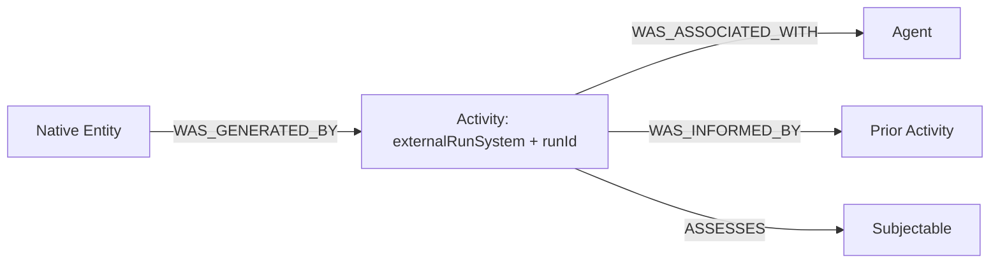

# Biotech: one application slice

Start with [the port map](APPLICATION-PORTS.md). Application ID is `biotech`; the shared KS binding is
`biotech-graph`. Despite its name, that binding also needs Biotech **PostgreSQL** for the common operational
KS component. The graph is native domain storage, not the operational verification-run database.

## Schema authority and the small read route

Read [Biotech AGENTS](../../../../../../biotech/AGENTS.md), then
[BKS AGENTS](../../../../../../biotech/biotech-knowledge-services/AGENTS.md) before changes.
[PIN.json](../../../../../../biotech/biotech-knowledge-services/schema/pinned/PIN.json) currently selects
**biotech-schema-v2.2.0**. BKS owns authoring under
[schema/source](../../../../../../biotech/biotech-knowledge-services/schema/source); `biotech-meta` is historical.
The current authored release's
[kernel.graphql](../../../../../../biotech/biotech-knowledge-services/schema/source/biotech-schema-v2.2.0/sdl/modules/kernel.graphql)
contains the provenance fields. Author a new version through the BKS release process; never edit the
frozen pinned bundle or generated workspace as replacement authority.

| Question | Minimal generated route |
| --- | --- |
| Where to start | [workspace/START_HERE](../../../../../../biotech/biotech-knowledge-services/workspace/START_HERE.md) |
| MC run identity and provenance relationships | [kernel-and-provenance](../../../../../../biotech/biotech-knowledge-services/workspace/domains/kernel-and-provenance.md) → [Activity](../../../../../../biotech/biotech-knowledge-services/workspace/nodes/Activity.md), then its linked relationship cards |
| Native reports and assertions | [derived-knowledge-and-reports](../../../../../../biotech/biotech-knowledge-services/workspace/domains/derived-knowledge-and-reports.md) → selected Report/Assertion cards |
| Sources/documents/evidence | [sources-documents-and-media](../../../../../../biotech/biotech-knowledge-services/workspace/domains/sources-documents-and-media.md), [studies-and-evidence](../../../../../../biotech/biotech-knowledge-services/workspace/domains/studies-and-evidence.md) |
| F1 diagnostics and biomarkers | [diagnostics-and-devices](../../../../../../biotech/biotech-knowledge-services/workspace/domains/diagnostics-and-devices.md), [substances-and-biology](../../../../../../biotech/biotech-knowledge-services/workspace/domains/substances-and-biology.md) |
| F2 products/formulas/ingredients/studies | [products-and-commerce](../../../../../../biotech/biotech-knowledge-services/workspace/domains/products-and-commerce.md) → Product/ProductVariant/Package/LabelVersion; substances and studies domains above |

From `biotech/biotech-knowledge-services`, after the normal owner build if `dist` is absent:

```powershell
node packages/schema-workspace/dist/cli.js get node:Activity
node packages/schema-workspace/dist/cli.js neighbors node:Activity --depth 1 --json
node packages/schema-workspace/dist/cli.js pattern --question Q-K-05 --json
node packages/schema-workspace/dist/cli.js search 'Mission Control run lineage' --mode lexical --limit 5
rg -n 'missionId|activationId|runId|WAS_INFORMED_BY' workspace/nodes/Activity.md
```

The schema-context artifact is advisory navigation, not a grant to write. Existing BKS commands regenerate
and check cards (`pnpm workspace:build`, `pnpm workspace:verify`); no copied schema subset is introduced here.

## The graph bridge is Activity, not a Mission node

`Activity` is keyed by `(externalRunSystem, runId)`, with optional `missionId`/`activationId` and accumulated
`operationIds`, `intentDigests`, `planDigests`, `receiptIds`. Retry attempts retain the run's Activity identity.
[write/context.ts](../../../../../../biotech/biotech-knowledge-services/packages/kg-ops/src/write/context.ts)
constructs its UID; [write/compile.ts](../../../../../../biotech/biotech-knowledge-services/packages/kg-ops/src/write/compile.ts)
creates the node and provenance links.



Activity can retain MC mission/activation attribution and exact verification/use/effect references:
`verificationRunRef`, `runManifestDigest`, `runSealKind`, `useDecisionRef`, `useDecisionDigest`,
`boundEffectDigest`, `effectKey`, `originatingOrigin`, `revocationEpoch`. These refer to authority/effects;
they do not move the verification engine into Neo4j. Native entities can have multiple generating
Activities; relationship `lastWriterRunId` is a provenance cache, not mission lifecycle authority.

## Read, apply and reconcile are distinct paths

| Need | Route and current limit |
| --- | --- |
| Transfer operational report | MC → shared KS `knowledge.read` → Biotech PostgreSQL operational report/custody. No automatic graph read. |
| Read native entities/relationships | BKS executor `/kg/read` through typed native read contracts, reached through the shared KS binding; the older MC adapter with its own envelope was deleted on 2026-10-27 (OC-D202). |
| Read an official graph report | KS [BiotechOfficialReads](../../../../../knowledge-services/packages/bindings/biotech-graph/src/read.ts) checks current eligibility and frozen digests via BKS reads. This class exists, but this audit found no production caller outside its definition; do not assume it is wired into KOP report read. |
| Apply through shared KOP | KS [Biotech apply port](../../../../../knowledge-services/packages/bindings/biotech-graph/src/apply-port.ts) (moved from the host by R5) → [BiotechGraphAdmission](../../../../../knowledge-services/packages/bindings/biotech-graph/src/admission.ts) → exact-use PostgreSQL admission/outbox; initial receipt is `pending_dispatch`. |
| Commit and recover graph effects | BKS [admission dispatch](../../../../../../biotech/biotech-knowledge-services/packages/kg-ops/src/admission/dispatch.ts) and [apply.ts](../../../../../../biotech/biotech-knowledge-services/packages/kg-ops/src/apply.ts): PostgreSQL outbox → graph write + `KsIntentMarker` → separate acknowledgment; an existing marker permits re-acknowledgment without reapplying. No cross-database atomic transaction. |

Receipt-first recovery and graph marker idempotency exist. They do not alone satisfy WI-05/RV-06:
after a real graph commit and missing protocol acknowledgment, a fresh process must recover the exact
original result without duplicate writes. `pending_dispatch` is not committed ingestion; `native_only`
is unresolved; required graph readback remains a separate promise.

## The big SDL and the executable API

Authored source → frozen release/pin → generated schema workspace. The consumer GraphQL API adds a
separately fingerprinted executable projection through
[projection.ts](../../../../../../biotech/biotech-knowledge-services/apps/graphql-api/src/projection.ts) and
[projection manifest](../../../../../../biotech/biotech-knowledge-services/apps/graphql-api/projection/manifest.json).
The manifest omits operational surfaces such as `CaptureAttempt` and `*.lastWriterRunId` from that API.
An SDL field therefore does not guarantee product GraphQL exposure. Native ingestion uses the executor;
consumer GraphQL is not the graph write interface. Fly service configuration is compute placement,
not a second graph store; pinning a schema does not establish today's Aura deployment.

For F1, report and ingestion-intent outputs do not require native apply. For F2, preserve label/formula
versions, unresolved printed ingredients and study roles; compound overlap does not prove sponsorship.
Use [PROOFS](PROOFS.md) §§8–9 for the actual fixture contracts. Later user/product services need their own
readiness review; the presence of graph types or a product BFF is not that review.
